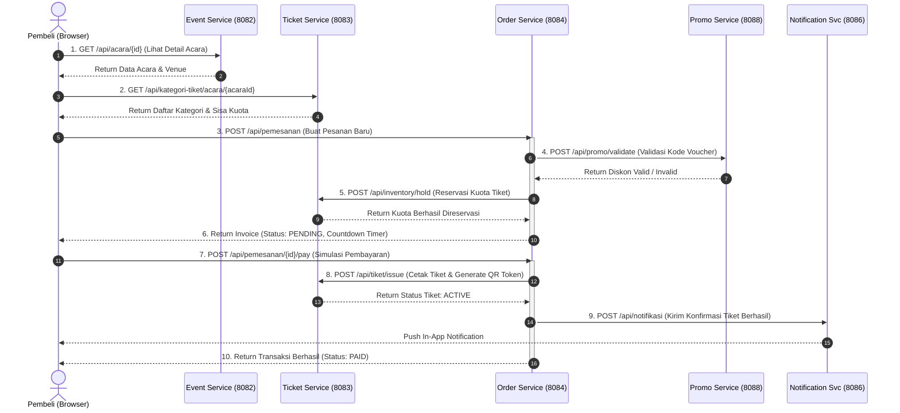
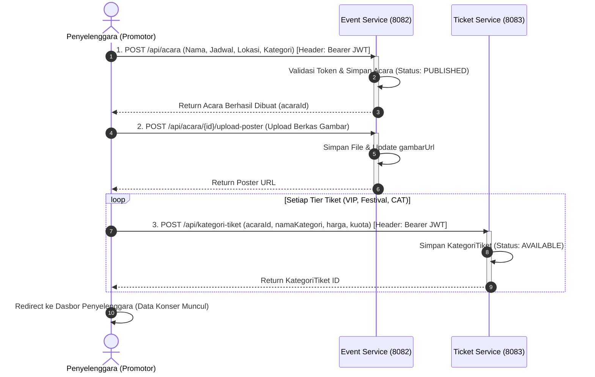

# PROPOSAL PROYEK DAN DOKUMENTASI TEKNIS KOMPREHENSIF
## SISTEM MANAJEMEN DAN TRANSAKSI TIKET KONSER DIGITAL BERBASIS ARSITEKTUR MICROSERVICES

---

### IDENTITAS PROYEK
* **Nama Sistem / Produk**: **TIKARA** (Tiket & Konser Nusantara)
* **Kategori Perangkat Lunak**: *Enterprise Event Management & Digital Ticketing Platform*
* **Pendekatan Arsitektur**: *Distributed Microservices Architecture*
* **Teknologi Utama**: Java 17, Spring Boot 3.4.3, Spring Security 6, Spring Data JPA, PostgreSQL, RESTful APIs, Vanilla Web Technologies (HTML5, Modern CSS3, Vanilla ES6+ JavaScript), JSON Web Token (JJWT 0.12.6)
* **Target Lingkungan**: Full-Stack Multi-Service Ecosystem
* **Dokumen Versi**: 1.0.0 (Comprehensive Release)
* **Tanggal Penyusunan**: September 2026
* **Status Proyek**: Aktif dalam Tahap Integrasi & Pengembangan Lanjutan

---

## DAFTAR ISI

1. [Identitas Proyek & Lembar Pengesahan](#identitas-proyek)
2. [Executive Summary (Ringkasan Eksekutif)](#1-executive-summary)
3. [Latar Belakang Proyek](#2-latar-belakang)
4. [Identifikasi Permasalahan Industri Ticketing](#3-identifikasi-permasalahan)
5. [Tujuan dan Manfaat Proyek](#4-tujuan-dan-manfaat-proyek)
6. [Gambaran Umum Produk (Product Overview)](#5-gambaran-umum-produk)
7. [Benchmark & Referensi Industri: Komparasi dengan Loket.com](#6-benchmark--referensi-industri)
8. [Konsep Fundamental dan Paradigma Arsitektur](#7-konsep-fundamental-dan-paradigma-arsitektur)
9. [Arsitektur Microservices TIKARA](#8-arsitektur-microservices-tikara)
10. [Struktur Fisik Repository Proyek](#9-struktur-fisik-repository-proyek)
11. [Spesifikasi Mendalam 9 Layanan Microservice](#10-spesifikasi-mendalam-9-layanan-microservice)
12. [Pola Arsitektur Berlapis Internal (Internal Layered Architecture)](#11-pola-arsitektur-berlapis-internal)
13. [Domain Model dan Entitas Data Sistem](#12-domain-model-dan-entitas-data-sistem)
14. [Role-Based Access Control (RBAC) & Matriks Otorisasi](#13-role-based-access-control-rbac)
15. [Alur Proses Bisnis End-to-End (End-to-End Business Flow)](#14-alur-proses-bisnis-end-to-end)
16. [Diagram Alur Sistem (System Flow & Sequence Diagrams)](#15-diagram-alur-sistem)
17. [Komunikasi dan Sinkronisasi Antar-Layanan](#16-komunikasi-dan-sinkronisasi-antar-layanan)
18. [Spesifikasi Tumpukan Teknologi (Technology Stack)](#17-spesifikasi-tumpukan-teknologi)
19. [Matriks Status Implementasi Fitur](#18-matriks-status-implementasi-fitur)
20. [Kronologi dan Riwayat Progres Pengembangan](#19-kronologi-dan-riwayat-progres-pengembangan)
21. [Arsitektur Dasbor Multi-Peran (Role-Based Dashboard)](#20-arsitektur-dasbor-multi-peran)
22. [Arsitektur Keamanan Siber dan Proteksi Data](#21-arsitektur-keamanan-siber)
23. [Roadmap Pengembangan Jangka Panjang (Phased Roadmap)](#22-roadmap-pengembangan-jangka-panjang)
24. [Rekomendasi Peningkatan Arsitektur Menuju Skala Produksi](#23-rekomendasi-peningkatan-arsitektur)
25. [Ruang Lingkup dan Batasan Sistem Saat Ini (Scope & Limitations)](#24-ruang-lingkup-dan-batasa-sistem)
26. [Keunggulan Kompetitif dan Proposisi Nilai TIKARA](#25-keunggulan-kompetitif-dan-proposisi-nilai)
27. [Kesimpulan](#26-kesimpulan)
28. [Lampiran: Pohon Direktori Source Code](#27-lampiran-pohon-direktori-source-code)

---

## 1. EXECUTIVE SUMMARY

**TIKARA** adalah platform ekosistem digital terpadu untuk pengelolaan, promosi, dan penjualan tiket event serta konser musik di Indonesia. Dikembangkan menggunakan pendekatan arsitektur *microservices* dengan tumpukan teknologi modern Java 17 dan Spring Boot 3, TIKARA memfasilitasi tiga kelompok pemangku kepentingan utama: **Pembeli (Buyer)**, **Penyelenggara Acara (Organizer/Promotor)**, dan **Pengelola Sistem (Administrator)**.

Berbeda dari sistem e-commerce tiket konvensional yang dibangun secara monolitik dan rentan mengalami *downtime* saat terjadi lonjakan pembelian masal (*ticket war*), TIKARA memecah domain bisnis menjadi **9 layanan microservice independen**:
1. `user_service` (Manajemen Pengguna, Profil & RBAC)
2. `event_service` (Katalog Konser, Detail & Moderasi Acara)
3. `ticket_service` (Manajemen Tier Tiket, Kuota & Inventaris)
4. `order_service` (Checkout, Transaksi & Riwayat Pemesanan)
5. `promo_service` (Kode Diskon, Voucher & Validasi Kuota Promo)
6. `notification_service` (Pusat Informasi & Notifikasi Transaksi)
7. `checkin_service` (Validasi Gate, Pindai QR Code & Kehadiran)
8. `queue_service` (Ruang Antrean Virtual / War Traffic Buffer)
9. `admin_service` (Audit Log, Pengawasan Ekosistem & Laporan Agregat)

Dokumen ini disusun sebagai panduan menyeluruh (*comprehensive blueprint*) bagi akademisi, arsitek sistem, pengembang perangkat lunak, maupun mitra bisnis untuk memahami landasan konseptual, arsitektur teknis, model basis data, mekanisme keamanan data, status implementasi aktual, serta peta jalan pengembangan TIKARA menuju platform kelas industri.

---

## 2. LATAR BELAKANG

Industri pertunjukan musik, festival seni, dan konser di Indonesia mengalami pertumbuhan eksponensial dalam beberapa tahun terakhir. Antusiasme masyarakat yang luar biasa terhadap musisi lokal maupun internasional mendorong terjadinya fenomena *war tiket*—situasi di mana puluhan hingga ratusan ribu penggemar berupaya mengakses platform pemesanan tiket pada detik yang bersamaan.

Namun, pertumbuhan industri ini belum diimbangi oleh keandalan infrastruktur perangkat lunak pada platform tiket konvensional. Seringkali, platform tiket mengalami kegagalan teknis (*crash*), transaksi ganda (*double booking*), ketidakkonsistenan kuota tiket (*overselling*), hingga kebocoran data pengguna akibat arsitektur sistem yang rapuh dan sentralistis (*single point of failure*).

Selain itu, promotor dan penyelenggara konser musik independen sering kali kesulitan mendapatkan platform yang menyediakan transparansi data penjualan real-time, kemudahan pengaturan kategori tiket (*seat tiering*), serta sistem validasi tiket di lokasi acara (*on-site gate check-in*) yang cepat dan anti-pemalsuan. 

Berdasarkan realitas tersebut, proyek **TIKARA** diinisiasi untuk membangun solusi perangkat lunak yang tidak sekadar berfungsi sebagai "etalase tiket", melainkan sebuah **Ekosistem Tata Kelola Konser Digital** yang modular, tangguh (*fault-tolerant*), berintegritas tinggi, dan berstandar internasional.

---

## 3. IDENTIFIKASI PERMASALAHAN

Dari sudut pandang rekayasa perangkat lunak dan proses bisnis tiket konser, diidentifikasi sejumlah persoalan mendasar:

1. **Kerapuhan Arsitektur Monolith terhadap Lonjakan Beban (Traffic Spikes)**:
   Pada sistem monolith, modul katalog, pembayaran, manajemen tiket, dan laporan operasional berjalan dalam satu proses dan satu basis data. Ketika beban pada modul pemilihan tiket melonjak drastis, seluruh sistem ikut mengalami degradasi performa atau lumpuh total, melumpuhkan operasional promotor dan pengguna lainnya.
2. **Masalah Integritas Data dan Kerentanan *Race Condition***:
   Pembelian tiket secara serentak pada milidetik yang sama sering memicu *race condition*, di mana tiket dengan kuota tersisa 1 berhasil dibeli oleh 2 pengguna berbeda (*overselling*). Hal ini merugikan promotor dan merusak reputasi platform.
3. **Penyalahgunaan dan Pemalsuan Tiket di Pintu Masuk (Gate Fraud)**:
   Format e-tiket statis berbasis file PDF tanpa mekanisme enkripsi atau validasi dinamis rawan diduplikasi oleh calo atau oknum tidak bertanggung jawab. Diperlukan validasi unik berbasis token QR code terintegrasi dengan pencatatan riwayat *check-in* sekali pakai.
4. **Ketiadaan Transparansi dan Kontrol Real-time bagi Penyelenggara**:
   Banyak penyelenggara acara tidak memiliki kendali langsung atas inventaris tiket mereka sendiri, sulit memantau laju konversi penjualan, serta terhambat dalam mengelola strategi promo dan kuota per kategori tiket.
5. **Inkonsistensi State Pengguna dan Masalah UX**:
   Pada antarmuka web modern, sinkronisasi identitas pengguna (*state management*), status otentikasi lintas domain, serta *loading/empty states* yang buruk sering membingungkan pengguna dan menurunkan kepercayaan saat bertransaksi.

---

## 4. TUJUAN DAN MANFAAT PROYEK

### 4.1. Tujuan Proyek
1. Merancang dan mengimplementasikan platform pemesanan tiket konser berbasis **Microservices Architecture** yang modular, memudahkan skalabilitas horizontal (*horizontal scaling*), dan memisahkan batasan domain secara tegas (*Separation of Concerns*).
2. Menerapkan kontrol akses berbasis peran (**Role-Based Access Control / RBAC**) yang membatasi hak akses antara Pembeli, Penyelenggara, dan Admin secara ketat baik di layer frontend maupun backend API.
3. Mengembangkan mekanisme pencatatan kuota tiket yang konsisten (*strict inventory reservation*) untuk mencegah terjadinya *overselling*.
4. Menyediakan sistem validasi tiket digital mandiri (*Check-in Service*) dengan kode unik yang memastikan satu tiket hanya dapat digunakan satu kali.
5. Membangun pengalaman pengguna (*User Experience*) modern dengan antarmuka yang responsif, navigasi dinamis, dan penanganan status error/loading berstandar profesional.

### 4.2. Manfaat Sistem
* **Bagi Penonton / Pembeli**: Mendapatkan akses pemesanan tiket yang transparan, aman dari penipuan calo, antrean virtual yang adil, serta kemudahan akses e-tiket langsung dari perangkat mobile.
* **Bagi Penyelenggara Konser**: Memiliki dasbor operasional mandiri untuk merilis konser, mengatur variasi harga (*ticket tiering*), mengelola kuota promosi, dan memantau analitik pendapatan secara real-time.
* **Bagi Pengelola Platform (Admin)**: Memiliki visibilitas penuh terhadap seluruh aktivitas ekosistem, kemampuan memoderasi kelayakan konser, audit trail jejak aktivitas pengguna, dan laporan finansial konsolidasi.

---

## 5. GAMBARAN UMUM PRODUK (PRODUCT OVERVIEW)

**TIKARA** bukan sekadar situs web statis untuk menjual voucher acara, melainkan sebuah platform perangkat lunak terintegrasi yang mencakup siklus hidup konser secara utuh (*Full Event Lifecycle*), mulai dari:
* **Fase Pra-Acara**: Perencanaan konser oleh promotor, penentuan venue, kurasi genre musik, pembuatan kategori harga tiket (VIP, Early Bird, Festival, CAT), pengaturan jadwal rilis tiket, dan alokasi kode voucher diskon.
* **Fase Penjualan & Transaksi**: Pencarian konser oleh penggemar musik dengan filter multi-parameter (kota, genre musik, kata kunci, rentang tanggal), ruang antrean virtual saat trafik puncak (*virtual queue buffer*), pemilihan kursi/kategori, reservasi kuota sementara, integrasi checkout pesanan, dan konfirmasi pembayaran.
* **Fase Distribusi E-Tiket**: Penerbitan kode QR tiket unik yang tersimpan di dompet tiket digital pengguna (*My Tickets*) dengan enkripsi ID pemesanan.
* **Fase Hari-H Acara (On-Site Execution)**: Pemindaian kode QR di pintu masuk konser (*gate validation*), verifikasi keabsahan tiket secara instan, dan pencegahan penggunaan ulang tiket.
* **Fase Pasca-Acara**: Rekapitulasi jumlah kehadiran, pelaporan penjualan akhir promotor, audit transaksi, dan ulasan serta rating konser dari penonton.

TIKARA beroperasi secara multi-platform pada peramban web modern, dioptimalkan untuk perangkat *desktop*, *tablet*, hingga *smartphone*, tanpa mewajibkan pengguna mengunduh aplikasi terpisah untuk sekadar mengeksplorasi konser.

---

## 6. BENCHMARK & REFERENSI INDUSTRI: KOMPARASI DENGAN LOKET.COM

Dalam perancangan proses bisnis dan pengalaman pengguna, TIKARA mengkaji platform manajemen tiket terkemuka di Indonesia, yaitu **Loket.com (Loket for Business & Loket.com Consumer)** sebagai tolak ukur (*conceptual benchmark*).

Loket.com diakui sebagai pionir industri yang berhasil menyatukan kebutuhan penonton ritel dengan kebutuhan promotor konser berskala stadion. Namun demikian, TIKARA bukanlah duplikasi dari Loket.com; TIKARA mengadopsi prinsip-prinsip operasional terbaiknya dan mendesain ulang arsitekturnya menjadi sistem microservices terdistribusi yang lebih modular, independen, dan adaptif untuk kebutuhan infrastruktur mandiri.

Berikut adalah tabel komparasi konseptual antara standar industri modern (seperti Loket.com) dan implementasi arsitektur pada TIKARA:

| Aspek Operasional / Fitur | Platform Event Ticketing Modern (Loket.com) | Implementasi Desain & Arsitektur TIKARA |
| :--- | :--- | :--- |
| **Pemisahan Peran Pengguna** | Akun pengguna publik dan portal promotor terpisah (*Loket Event Creator Portal*). | Terintegrasi dalam sistem identitas tunggal dengan 3 Role eksplisit: `PEMBELI`, `PENYELENGGARA`, `ADMIN` melalui sistem RBAC dinamis. |
| **Manajemen Acara (Event)** | Promotor mengunggah poster, jadwal, deskripsi, dan denah tempat duduk secara mandiri. | Ditangani secara mandiri oleh `event_service` melalui antarmuka `create-event.html` dan `my-events.html` dengan isolasi data berbasis `organizerId`. |
| **Kategori & Tiering Tiket** | Dukungan multi-tier (Early Bird, Presale, VIP, Festival, dsb.) dengan kuota independen. | Dikelola secara spesifik oleh `ticket_service` (`KategoriTiket`), memungkinkan fleksibilitas penentuan tanggal mulai/selesai jual dan status ketersediaan. |
| **Penanganan Trafik Puncak** | Sistem *Virtual Queue Waiting Room* untuk mengatur antrean masuk saat *ticket war*. | Disediakan modul berdedikasi `queue_service` (`AntreanPembeli`) yang menjaga beban server backend agar tidak kolaps akibat request serentak. |
| **Checkout & Pemesanan** | *Holding time* (batas waktu pembayaran) 15-30 menit sebelum kuota tiket dilepas kembali. | Dikelola oleh `order_service` dengan atribut `tenggatPembayaran` dan status pesanan otomatis (`PENDING`, `PAID`, `EXPIRED`, `CANCELLED`). |
| **Promosi & Diskon** | Kupon diskon berbasis persentase, potongan nominal maksimal, dan kuota pemakaian. | Ditangani oleh `promo_service` (`KodePromo` & `PenggunaanPromo`) yang dapat divalidasi saat checkout pesanan. |
| **Validasi di Lokasi Acara** | Aplikasi pemindai barcode/QR code di pintu gerbang untuk petugas tiket. | Disediakan modul berdedikasi `checkin_service` (`RiwayatCheckin`) dengan pencatatan lokasi gate, ID petugas, dan timestamp pemindaian. |
| **Audit & Pengawasan** | Panel admin internal untuk pengawasan transaksi, kecurangan, dan sengketa dana. | Dikelola oleh `admin_service` (`AuditLog` & `LaporanPenjualan`) untuk memastikan integritas operasional ekosistem. |

> [!NOTE]
> Tabel di atas merepresentasikan tolak ukur konseptual dan keselarasan visi produk. TIKARA mengimplementasikan komponen-komponen ini secara modular dalam repositori berbasis Spring Boot sesuai batasan rancang bangun yang dijelaskan dalam dokumen ini.

---


## 7. KONSEP FUNDAMENTAL DAN PARADIGMA ARSITEKTUR

### 7.1. Apa itu Arsitektur Perangkat Lunak Terdistribusi?
Secara mendasar, arsitektur perangkat lunak adalah cetak biru struktural bagaimana sekumpulan kode, pustaka, dan basis data berinteraksi untuk mewujudkan tujuan fungsional aplikasi. 

Dalam arsitektur tradisional (**Monolith**), seluruh logika aplikasi—mulai dari pendaftaran akun pengguna, katalog acara, stok tiket, pembayaran, hingga pengiriman email notifikasi—dikompilasi dan dijalankan dalam satu unit aplikasi tunggal yang berbagi satu basis data terpusat. Ketika satu baris kode di modul laporan mengalami kesalahan memori atau mengalami beban komputasi tak terbatas, seluruh aplikasi dari modul login hingga pembayaran ikut terhenti.

Sebaliknya, **Microservices Architecture** adalah pendekatan perancangan perangkat lunak di mana sistem dibangun sebagai sekumpulan layanan mandiri berukuran kecil (*loosely-coupled services*). Setiap layanan:
1. Berfokus pada satu domain bisnis tertentu (*Single Responsibility Principle*).
2. Memiliki proses komputasinya sendiri (misalnya, berjalan pada port jaringan terpisah).
3. Mengelola basis data domainnya sendiri (*Database-per-Service Pattern*).
4. Berkomunikasi dengan layanan lain menggunakan protokol standar industri, seperti antarmuka pemrograman aplikasi web (**RESTful API**) berbasis format data **JSON** (*JavaScript Object Notation*).

---

## 8. ARSITEKTUR MICROSERVICES TIKARA

### 8.1. Alasan Pemilihan Microservices pada TIKARA
TIKARA mengadopsi arsitektur microservices untuk menyelesaikan tantangan spesifik platform penjualan tiket konser:

```
                  ┌─────────────────────────────────────────────────────────────┐
                  │                      TIKARA CLIENT                          │
                  │   Desktop Browser / Mobile Drawer / Responsive Web Engine   │
                  └──────────────┬───────────────────────────────┬──────────────┘
                                 │ HTTP REST / JWT Headers       │
         ┌───────────────────────┼───────────────────────────────┼───────────────────────┐
         │                       │                               │                       │
         ▼                       ▼                               ▼                       ▼
┌──────────────────┐   ┌──────────────────┐            ┌──────────────────┐   ┌──────────────────┐
│   USER SERVICE   │   │  EVENT SERVICE   │            │  TICKET SERVICE  │   │  ORDER SERVICE   │
│    (Port 8081)   │   │   (Port 8082)    │            │   (Port 8083)    │   │   (Port 8084)    │
│  db_user_service │   │ db_event_service │            │ db_ticket_service│   │ db_order_service │
└──────────────────┘   └──────────────────┘            └──────────────────┘   └─────────┬────────┘
         │                       │                               │                      │
         │                       │                               │        ┌─────────────┴─────────────┐
         ▼                       ▼                               ▼        ▼                           ▼
┌──────────────────┐   ┌──────────────────┐            ┌──────────────────┐   ┌───────────────────────────┐
│  QUEUE SERVICE   │   │  ADMIN SERVICE   │            │ CHECK-IN SERVICE │   │ PROMO & NOTIFICATION SVC  │
│   (Port 8085)    │   │   (Port 8089)    │            │   (Port 8087)    │   │  (Port 8088 & Port 8086)  │
│ db_queue_service │   │ db_admin_service │            │db_checkin_service│   │db_promo / db_notification │
└──────────────────┘   └──────────────────┘            └──────────────────┘   └───────────────────────────┘
```

1. **Skalabilitas Asimetris (*Asymmetric Scaling*)**:
   Pada konser musisi legendaris, trafik membaca katalog konser (`event_service`) dan pemesanan tiket (`ticket_service` & `queue_service`) melonjak hingga ribuan kali lipat. Sementara itu, fitur pengeditan profil pengguna (`user_service`) atau pendaftaran promo (`promo_service`) memiliki beban normal. Dengan microservices, server dapat mengalokasikan sumber daya komputasi lebih besar hanya pada service yang sedang menghadapi lonjakan trafik tanpa perlu memboroskan sumber daya pada service lainnya.
2. **Ketahanan terhadap Kegagalan Sistem (*Fault Isolation & Resilience*)**:
   Jika server pengiriman email/notifikasi (`notification_service`) mengalami gangguan jaringan pihak ketiga, proses pembelian tiket di `order_service` tetap berjalan mulus. Pengguna tetap dapat membeli tiket, dan pesan notifikasi dapat diantrekan secara terpisah.
3. **Pemisahan Batasan Domain (*Separation of Concerns*)**:
   Setiap tim pengembang dapat memfokuskan perhatian pada domain spesifik. Pengembang logika tiket hanya berinteraksi dengan entitas kuota dan status ketersediaan, tanpa terbebani oleh kompleksitas logika autentikasi kata sandi atau validasi berkas identitas promotor.
4. **Siklus Rilis Independen (*Independent Deployability*)**:
   Pembaruan algoritma perhitungan promo di `promo_service` dapat dikompilasi dan disebarkan (*deploy*) ulang ke server tanpa mengharuskan restart pada `event_service` atau `user_service`, menjamin ketersediaan sistem sepanjang waktu (*zero-downtime deployment*).

### 8.2. Tantangan Nyata Arsitektur Microservices & Mitigasinya pada TIKARA
Sebagai komitmen keterbukaan akademik dan profesionalisme teknis, proposal ini mencatat sejumlah tantangan nyata dari arsitektur microservices serta strategi penanganannya pada TIKARA:

* **Tantangan 1: Konsistensi Data Terdistribusi (*Distributed Data Consistency*)**:
  Karena `order_service` dan `ticket_service` memiliki basis data terpisah, sistem tidak dapat menggunakan transaksi basis data ACID lokal sederhana antar-tabel.
  *Mitigasi TIKARA*: Penerapan mekanisme *Ticket Reservation & Holding Time*. Kuota tiket direservasi sementara (`direservasi`) dengan batas waktu pembayaran yang tegas (`tenggatPembayaran`). Jika transaksi kedaluwarsa, kuota secara otomatis dikembalikan ke pool ketersediaan.
* **Tantangan 2: Pengelolaan Identitas dan Keamanan Lintas Layanan**:
  Pengguna login di `user_service`, namun harus dapat memanggil API di `event_service` dan `ticket_service`.
  *Mitigasi TIKARA*: Penggunaan **Stateless JSON Web Token (JWT)** yang ditandatangani secara kriptografis menggunakan algoritma `HMAC-SHA256`. Setiap microservice memiliki `JwtAuthenticationFilter` dan kunci rahasia bersama (*shared secret key*) untuk memvalidasi identitas (`userId`), alamat email (`subject`), dan peran pengguna (`role`) tanpa perlu melakukan query jaringan berulang ke `user_service` pada setiap request API.
* **Tantangan 3: Kompleksitas Komunikasi & Orchestration**:
  Client browser harus berinteraksi dengan layanan yang berada pada nomor port berbeda di lingkungan pengembangan lokal (misalnya port 8081, 8082, 8083).
  *Mitigasi TIKARA*: Modul `config.js` dan `script.js` menyediakan abstraksi sentral lingkungan (`window.TIKARA_CONFIG`), pembacaan status otentikasi terpadu (`getAuthState()`), pembungkus request terotentikasi (`authFetch()`), serta pengaturan CORS (*Cross-Origin Resource Sharing*) yang ketat pada konfigurasi Spring Security setiap service.

---

## 9. STRUKTUR FISIK REPOSITORY PROYEK

Repositori proyek TIKARA diorganisasi dengan pola *Multi-Module Microservices Workspace* sebagai berikut:

```text
tiketkonser-fullstack
│
├── .vscode                      # Pengaturan IDE Visual Studio Code & ekstensi workspace
│
├── admin_service                # Microservice Pengawasan, Audit Log, dan Laporan Agregat (Port 8089)
│   ├── pom.xml                  # Konfigurasi dependensi Maven
│   └── src                      # Source code (Java) dan berkas resources (HTML/Properties)
│
├── checkin_service              # Microservice Validasi Gate & Pindai Tiket Acara (Port 8087)
│   ├── pom.xml
│   └── src
│
├── event_service                # Microservice Katalog Konser, Acara, & Kategori Genre (Port 8082)
│   ├── pom.xml
│   └── src
│
├── notification_service         # Microservice Penyampaian Informasi & Notifikasi Pengguna (Port 8086)
│   ├── pom.xml
│   └── src
│
├── order_service                # Microservice Pemesanan, Transaksi, & Riwayat Pesanan (Port 8084)
│   ├── pom.xml
│   └── src
│
├── promo_service                # Microservice Kode Diskon, Kupon, & Penggunaan Promo (Port 8088)
│   ├── pom.xml
│   └── src
│
├── queue_service                # Microservice Ruang Antrean Virtual / Buffer War Tiket (Port 8085)
│   ├── pom.xml
│   └── src
│
├── ticket_service               # Microservice Kategori Tiket, Harga, Kuota, & Penerbitan Tiket (Port 8083)
│   ├── pom.xml
│   └── src
│
├── user_service                 # Microservice Identitas, Otentikasi, Profil, & RBAC (Port 8081)
│   ├── pom.xml
│   └── src
│
└── uploads                      # Direktori Berkas Statis / Media yang Diunggah Pengguna
    └── avatars                  # Direktori penyimpanan berkas foto profil pengguna
```

---

## 10. SPESIFIKASI MENDALAM 9 LAYANAN MICROSERVICE

### 10.1. User Service (Port 8081)
* **Tanggung Jawab Utama**: Pusat keabsahan identitas pengguna, manajemen sesi, dan otorisasi peran (*Single Source of Truth for Identity*).
* **Fitur Utama**:
  * Registrasi akun publik untuk peran `PEMBELI` dan `PENYELENGGARA`.
  * Kebijakan penutupan registrasi publik untuk peran `ADMIN` (pembuatan Admin dilakukan secara khusus melalui mekanisme basis data administratif demi keamanan).
  * Otentikasi login dengan verifikasi kata sandi berbasis algoritma hashing **BCrypt**.
  * Penerbitan token akses terenkripsi **JWT** (*JSON Web Token*) yang memuat klaim `userId`, `email`, dan `role`.
  * Pengelolaan profil pengguna (nama lengkap, nomor telepon/WhatsApp, foto profil avatar, alamat).
  * Alur pemulihan akun (*Account Recovery*): Permintaan kode OTP reset password 6-digit ke email, verifikasi OTP, dan pembaruan kata sandi baru yang aman.
* **Basis Data**: `db_user_service` (Tabel: `pengguna`, `profil_pengguna`, `reset_password_otp`).

### 10.2. Event Service (Port 8082)
* **Tanggung Jawab Utama**: Mengelola seluruh siklus hidup informasi konser musik dan festival.
* **Fitur Utama**:
  * Penjelajahan katalog publik konser dengan penyaringan multi-parameter (pencarian kata kunci artis/venue, filter kota, filter genre musik, dan pengurutan waktu).
  * Halaman detail konser publik lengkap dengan rincian jadwal, peta venue, deskripsi acara, dan daftar harga awal.
  * Form pembuatan event mandiri bagi `PENYELENGGARA` (`create-event.html`) lengkap dengan pengunggahan poster acara (`POST /api/acara/{id}/upload-poster`).
  * Manajemen konser milik penyelenggara (`my-events.html`) dengan isolasi hak akses data (`organizerId == currentUserId`).
  * Fasilitas moderasi acara oleh `ADMIN` (`POST /api/acara/{id}/moderate`).
  * Sistem rating dan ulasan konser oleh pembeli (`ulasan`).
* **Basis Data**: `db_event_service` (Tabel: `acara`, `kategori`, `acara_kategori`, `ulasan`).

### 10.3. Ticket Service (Port 8083)
* **Tanggung Jawab Utama**: Tata kelola variasi kategori tiket (*ticket tiering*), kuota kapasitas, alur reservasi, dan pencetakan e-tiket unik.
* **Fitur Utama**:
  * Konfigurasi kategori tiket per acara (contoh: VIP, Festival Presale, Regular, Tribune) dengan atribut harga, kuota total, batas waktu penjualan, dan status ketersediaan.
  * Antarmuka pemilihan tiket bagi pembeli (`pilih-tiket.html`) dengan kalkulasi subtotal langsung dan validasi batas maksimal pemesanan per akun.
  * Manajemen status inventaris (`AVAILABLE`, `SOLD_OUT`, `ENDED`).
  * Penerbitan tiket digital individual (`tiket`) yang terafiliasi dengan ID pesanan dan dilengkapi kode string QR unik untuk verifikasi masuk.
  * Halaman dompet digital pembeli (`my-tickets.html`) untuk menampilkan seluruh tiket yang dimiliki beserta status keabsahannya.
* **Basis Data**: `db_ticket_service` (Tabel: `kategori_tiket`, `tiket`).

### 10.4. Order Service (Port 8084)
* **Tanggung Jawab Utama**: Mengelola seluruh siklus transaksi keuangan, checkout keranjang tiket, pencatatan status pembayaran, dan riwayat pesanan.
* **Fitur Utama**:
  * Pembuatan pesanan baru (`Pemesanan`) dengan nomor invoice unik (contoh: `ORD-20260907-XXXXX`).
  * Rincian pemesanan per kategori tiket (`DetailPemesanan`).
  * Pengendalian batas waktu pembayaran (*payment countdown*) berbasis atribut `tenggatPembayaran`.
  * Transisi status transaksi yang terdefinisi secara baku: `PENDING` (menunggu pembayaran), `PAID` (berhasil dibayar), `EXPIRED` (kedaluwarsa), dan `CANCELLED` (dibatalkan).
  * Halaman ringkasan checkout (`checkout.html`), simulasi pelunasan tagihan (`pembayaran.html`), dan riwayat seluruh transaksi pengguna (`my-orders.html`).
* **Basis Data**: `db_order_service` (Tabel: `pemesanan`, `detail_pemesanan`).

### 10.5. Promo Service (Port 8088)
* **Tanggung Jawab Utama**: Tata kelola skema diskon, kupon promosi promotor, dan pengendalian batas penggunaan voucher.
* **Fitur Utama**:
  * Pembuatan kode promo unik (contoh: `TIKARABANDUNG`, `EARLYBIRD10`).
  * Pengaturan persentase diskon, batas potongan nominal maksimal (misal: diskon 15% maksimal Rp 100.000), batas minimum nominal transaksi, serta kuota penggunaan total.
  * Validasi masa aktif kode promo (`mulaiBerlaku` hingga `selesaiBerlaku`).
  * Pencatatan riwayat pemakaian promo per pengguna (`PenggunaanPromo`) untuk mencegah satu akun memanfaatkan promo berulang kali melebihi kuota kebijakan.
* **Basis Data**: `db_promo_service` (Tabel: `kode_promo`, `penggunaan_promo`).

### 10.6. Notification Service (Port 8086)
* **Tanggung Jawab Utama**: Pusat penyampaian pesan, pengumuman, dan notifikasi peristiwa transaksi kepada pengguna.
* **Fitur Utama**:
  * Pengarsipan notifikasi berbasis pengguna (`Notifikasi`) dengan judul, isi pesan, kategori tipe (INFO, TRANSAKSI, PROMO, SISTEM), dan status keterbacaan (`dibaca = true/false`).
  * Antarmuka web notifikasi (`notifications.html`) dengan indikator angka badge belum dibaca (*unread count badge*) pada navbar aplikasi.
  * Fondasi arsitektural untuk ekspansi integrasi pihak ketiga di masa mendatang (seperti penyedia layanan SMTP Email, SMS Gateway, maupun WhatsApp Business API).
* **Basis Data**: `db_notification_service` (Tabel: `notifikasi`).

### 10.7. Check-in Service (Port 8087)
* **Tanggung Jawab Utama**: Verifikasi keabsahan fisik tiket di pintu masuk acara (*gate control*) dan pencegahan penipuan tiket ganda.
* **Fitur Utama**:
  * Endpoint validasi kode QR tiket (`POST /api/checkin/validate`).
  * Pemeriksaan status tiket: Memastikan tiket berstatus `ACTIVE` dan belum pernah diverifikasi sebelumnya.
  * Pencatatan riwayat *check-in* (`RiwayatCheckin`): Mencatat ID tiket, ID acara, lokasi gerbang masuk (*Gate A, Gate B, VIP Gate*), ID petugas pemindai, dan waktu tepat penonton memasuki venue (*timestamp*).
  * Pembaruan status tiket secara atomik menjadi `USED` untuk menggagalkan upaya pemindaian ulang salinan tiket oleh orang lain.
* **Basis Data**: `db_checkin_service` (Tabel: `riwayat_checkin`).

### 10.8. Queue Service (Port 8085)
* **Tanggung Jawab Utama**: Penyangga beban (*traffic buffer*) dan ruang tunggu antrean virtual (*Virtual Waiting Room*) pada konser dengan animo masal.
* **Fitur Utama**:
  * Pengalokasian nomor urut antrean digital bagi setiap pengguna yang mengakses konser tertentu (`AntreanPembeli`).
  * Pengaturan status antrean: `WAITING` (menunggu giliran), `PROCESSING` (diberi izin melanjutkan ke pemilihan tiket), dan `COMPLETED` (telah menyelesaikan antrean).
  * Penyeimbang laju request ke `ticket_service` agar kapasitas basis data relasional tetap stabil dan terlindung dari serangan lonjakan *Denial-of-Service* yang tidak disengaja.
  * Antarmuka visual ruang tunggu (`waiting-room.html`) dengan indikator estimasi waktu tunggu dan pembaruan nomor antrean otomatis.
* **Basis Data**: `db_queue_service` (Tabel: `antreanpembeli`).

### 10.9. Admin Service (Port 8089)
* **Tanggung Jawab Utama**: Pengawasan menyeluruh terhadap tata kelola ekosistem platform TIKARA dan rekapitulasi data administratif.
* **Fitur Utama**:
  * Pencatatan log aktivitas sistem (*System Audit Log*): Merekam setiap aksi administratif penting, modul yang dipanggil, alamat IP, dan rincian perubahan.
  * Agregasi laporan performa penjualan konser (`LaporanPenjualan`): Menghitung total tiket terjual, total omzet transaksi, dan performa promotor per periode.
  * Dasbor pengawasan eksekutif (`admin-dashboard.html`) bagi Administrator untuk memverifikasi konser baru yang diajukan penyelenggara, menonaktifkan akun yang melanggar kebijakan, dan memantau status operasional platform.
* **Basis Data**: `db_admin_service` (Tabel: `audit_log`, `laporan_penjualan`).

---


## 11. POLA ARSITEKTUR BERLAPIS INTERNAL (INTERNAL LAYERED ARCHITECTURE)

Setiap microservice di dalam proyek TIKARA mengadopsi pola rancang bangun perangkat lunak berlapis (**Layered Architecture Pattern**) berbasis konvensi baku Spring Boot dan *Clean Code Principles*. Pola ini menjamin bahwa kode memiliki pemisahan tanggung jawab yang rapi, mudah diuji secara modular, dan tidak mencampuradukkan logika presentasi dengan logika penyimpanan data.

Berikut adalah uraian fungsi setiap lapisan dan direktori internal:

```
[ Client Request ]
       │
       ▼
┌────────────────────────────────────────────────────────┐
│  controller / WebViewController                        │
│  - Menerima HTTP Request (GET, POST, PUT, DELETE)      │
│  - Melakukan validasi awal payload (@Valid)            │
│  - Mengembalikan ResponseEntity<DTO> & HTTP Status     │
└───────────────────────┬────────────────────────────────┘
                        │
                        ▼
┌────────────────────────────────────────────────────────┐
│  service (Interface) & service/impl (Implementation)   │
│  - Mengeksekusi seluruh aturan bisnis (Business Logic) │
│  - Mengelola transaksi atomik (@Transactional)         │
│  - Memanggil SecurityContext & kalkulasi matematika    │
└───────────────────────┬────────────────────────────────┘
                        │
                        ▼
┌────────────────────────────────────────────────────────┐
│  repository (Spring Data JPA)                          │
│  - Abstraksi akses basis data relasional               │
│  - Query kustom, SpEL, & Dynamic Specification JPA     │
└───────────────────────┬────────────────────────────────┘
                        │
                        ▼
┌────────────────────────────────────────────────────────┐
│  entity (JPA Database Entities)                        │
│  - Pemetaan tabel PostgreSQL ke objek Java POJO        │
│  - Definisi relasi ORM (@ManyToOne, @ManyToMany, dsb)  │
└───────────────────────┬────────────────────────────────┘
                        │
                        ▼
               [ Database Server ]
```

### 11.1. `config` (Konfigurasi Aplikasi)
Berisi kelas-kelas konfigurasi Spring Framework, inisialisasi bean global, dokumentasi OpenAPI/Swagger (`OpenApiConfig.java`), pembenihan data awal sistem saat startup (`DataSeeder.java`), serta pengaturan CORS (*Cross-Origin Resource Sharing*).

### 11.2. `controller` (Lapisan Antarmuka REST API)
Bertindak sebagai pintu gerbang (*endpoint*) yang menerima panggilan HTTP dari client web atau mobile. Lapisan ini bertugas:
* Memetakan URI endpoint (misalnya `@RequestMapping("/api/acara")`).
* Memvalidasi format masukan secara deklaratif menggunakan anotasi `@Valid`.
* Meneruskan parameter ke lapisan Service dan membungkus hasil keluaran ke dalam format respons baku `ResponseEntity<T>` dengan kode status HTTP yang semantik (200 OK, 201 Created, 204 No Content).
* Pada beberapa service, terdapat `WebViewController` yang bertugas melayani rendering halaman HTML statis.

### 11.3. `entity` (Lapisan Objek Domain & Database ORM)
Merepresentasikan struktur tabel basis data relasional dalam bentuk kelas objek Java (POJO). Menggunakan anotasi standar **Jakarta Persistence (JPA)** seperti `@Entity`, `@Table`, `@Id`, `@GeneratedValue`, `@Column`, serta anotasi Lombok (`@Data`, `@Builder`, `@NoArgsConstructor`, `@AllArgsConstructor`) untuk mengeliminasi penulisan kode boilerplate getter/setter.

### 11.4. `handler` (Lapisan Penanganan Kesalahan Terpusat)
Mengimplementasikan kelas `@RestControllerAdvice` bernama `GlobalExceptionHandler.java`. Lapisan ini menangkap seluruh kegagalan eksekusi dan eksepsi bisnis khusus (seperti `NotFoundException`, `BadRequestException`, `ConflictException`, dan `MethodArgumentNotValidException`).
*Fungsi*: Mencegah keluarnya jejak error sistem mentah (*stack trace*) ke layar pengguna, dan secara otomatis mengubah error menjadi format respons JSON yang seragam (`ErrorResponse` dan `ValidationErrorResponse`).

### 11.5. `payload` (Lapisan Pertukaran Data / Data Transfer Objects - DTO)
Memisahkan representasi data internal (Entity) dengan representasi data yang dikirim dan diterima melalui jaringan. Dibagi menjadi dua sub-direktori:
* **`payload/req` (Request DTO)**: Struktur data yang dikirim oleh client ke server (contoh: `AcaraReq`, `KategoriTiketReq`, `PemesananReq`). Dilengkapi aturan validasi data seperti `@NotBlank`, `@NotNull`, `@Min`, `@Future`.
* **`payload/res` (Response DTO)**: Struktur data yang dikembalikan oleh server ke client (contoh: `AcaraRes`, `TiketRes`, `PageResponse<T>`).
*Keuntungan Arsitektur*: Mencegah kebocoran data sensitif (misalnya hash kata sandi pengguna tidak akan pernah terekspos karena tidak dimasukkan ke dalam DTO respons) dan melindungi sistem dari serangan injeksi parameter berlebih (*Over-Posting/Mass Assignment Attack*).

### 11.6. `repository` (Lapisan Akses Data)
Merupakan antarmuka (*interface*) yang mewarisi `JpaRepository<T, ID>` dan `JpaSpecificationExecutor<T>`. Menyediakan fungsi CRUD (Create, Read, Update, Delete) otomatis tanpa perlu menuliskan query SQL mentah. Jika diperlukan query kompleks, pengembang dapat menyusun query turunan (*derived query methods*) atau menggunakan *Dynamic JPA Specification*.

### 11.7. `security` (Lapisan Otorisasi dan Keamanan)
Bertanggung jawab menegakkan kebijakan keamanan siber di tingkat HTTP request:
* `SecurityConfig.java`: Menentukan rantai filter keamanan (`SecurityFilterChain`), menonaktifkan CSRF untuk arsitektur stateless REST API, mengatur sesi menjadi `SessionCreationPolicy.STATELESS`, dan mendefinisikan aturan akses endpoint publik vs terproteksi.
* `JwtAuthenticationFilter.java`: Filter khusus yang mencegat setiap request masuk, mengekstraksi token dari header `Authorization: Bearer <token>`, memvalidasi signature kriptografi, dan menyusun identitas pengguna ke dalam `SecurityContextHolder`.
* `JwtService.java`: Utilitas kriptografi untuk membedah klaim JWT, memeriksa masa kedaluwarsa (*expiration time*), dan mengambil ID/Role pengguna.

### 11.8. `service` & `service/impl` (Lapisan Logika Bisnis Utama)
* **`service/`**: Antarmuka murni (*pure interface*) yang mendefinisikan kontrak operasi logika bisnis yang tersedia (contoh: `AcaraService.java`).
* **`service/impl/`**: Kelas implementasi konkret (contoh: `AcaraServiceImpl.java`) yang dianotasi dengan `@Service` dan `@Transactional`. Di sinilah seluruh kalkulasi bisnis, validasi kepemilikan data promotor (*ownership validation*), pengecekan stok kuota tiket, dan orkestrasi pemanggilan repositori dieksekusi.

### 11.9. `utility` (Lapisan Bantuan & Helper)
Berisi kelas-kelas utilitas independen yang dapat digunakan berulang kali di seluruh lapisan:
* Mapper DTO-ke-Entity (misal: `EventMapper.java`, `TicketMapper.java`, `OrderMapper.java`).
* Spesifikasi filter dinamis (misal: `AcaraSpecification.java`).

### 11.10. `resources` (Sumber Daya & Aset Aplikasi)
* **`application.properties`**: Konfigurasi koneksi basis data JDBC PostgreSQL, nomor port server, pengaturan secret key JWT, dan konfigurasi logging.
* **`static/`**: Tempat tersimpannya aset antarmuka peramban (HTML, CSS, Vanilla JS, dan gambar).
* **`templates/`**: Template dokumen server-side jika service tertentu memanfaatkan template engine.

### 11.11. `test` & `target`
* **`src/test/java/`**: Tempat tersimpannya skenario pengujian unit (*Unit Tests*) dan pengujian integrasi (*Integration Tests*) berbasis framework JUnit 5 dan Mockito.
* **`target/`**: Direktori hasil proses kompilasi compiler Java (`javac`) dan Maven. Berisi berkas `.class`, arsip `.jar`, serta aset statis yang siap dijalankan oleh Java Virtual Machine (JVM). Direktori ini tidak diedit secara manual dan diabaikan oleh sistem pengontrol versi (*version control*).

### 11.12. Direktori `uploads/avatars`
Direktori tingkat repositori yang digunakan untuk menyimpan berkas statis biner hasil unggahan pengguna (khususnya foto profil avatar). Direktori ini dirancang secara modular agar di masa mendatang dapat dialihkan ke layanan penyimpanan berkas berbasis *Cloud Object Storage* (seperti Amazon S3 atau Google Cloud Storage) tanpa mengubah logika internal service.

---

## 12. DOMAIN MODEL DAN ENTITAS DATA SISTEM

Berdasarkan audit langsung terhadap source code Java pada seluruh microservice, TIKARA mengoperasikan **17 Entitas Basis Data** yang terisolasi sesuai batas domain layanannya masing-masing:

```
[user_service]
  Pengguna (1) ─────────── (1) ProfilPengguna
  Pengguna (1) ─────────── (N) ResetPasswordOtp

[event_service]
  Acara (1) ────────────── (N) Acara_Kategori ───────────── (N) Kategori
  Acara (1) ────────────── (N) Ulasan
  (Acara.organizerId ──► Pengguna.id [Logical Reference via JWT])

[ticket_service]
  KategoriTiket (1) ────── (N) Tiket
  (KategoriTiket.acaraId ──► Acara.id [Logical Reference])
  (Tiket.penggunaId ───────► Pengguna.id [Logical Reference])

[order_service]
  Pemesanan (1) ────────── (N) DetailPemesanan
  (Pemesanan.penggunaId ───► Pengguna.id [Logical Reference])
  (DetailPemesanan.kategoriTiketId ──► KategoriTiket.id [Logical Reference])

[promo_service]
  KodePromo (1) ────────── (N) PenggunaanPromo
  (PenggunaanPromo.penggunaId ──► Pengguna.id [Logical Reference])
  (PenggunaanPromo.pemesananId ─► Pemesanan.id [Logical Reference])

[notification_service]
  Notifikasi (penggunaId ──► Pengguna.id [Logical Reference])

[checkin_service]
  RiwayatCheckin (acaraId, tiketId, petugasId [Logical References])

[queue_service]
  AntreanPembeli (acaraId, penggunaId [Logical References])

[admin_service]
  AuditLog (penggunaId [Logical Reference])
  LaporanPenjualan (acaraId [Logical Reference])
```

Berikut adalah spesifikasi mendalam dari setiap entitas yang aktif dalam sistem:

### 12.1. Entitas Layanan `user_service`
1. **`Pengguna` (Tabel: `pengguna`)**:
   * *Tujuan*: Menyimpan akun kredensial dan peran dasar pengguna.
   * *Field*: `id` (Long, PK), `nama` (String), `email` (String, Unique), `kataSandiHash` (String), `peran` (String: PEMBELI / PENYELENGGARA / ADMIN), `createdAt` (LocalDateTime), `updatedAt` (LocalDateTime), `deletedAt` (LocalDateTime - Soft Delete).
   * *Relasi*: One-to-One dengan `ProfilPengguna`.
2. **`ProfilPengguna` (Tabel: `profil_pengguna`)**:
   * *Tujuan*: Menyimpan data demografis dan informasi personal pengguna.
   * *Field*: `id` (Long, PK), `pengguna` (Pengguna, FK), `nomorTelepon` (String), `tanggalLahir` (LocalDate), `alamat` (String), `fotoProfilUrl` (String), `createdAt` (LocalDateTime), `updatedAt` (LocalDateTime).
3. **`ResetPasswordOtp` (Tabel: `reset_password_otp`)**:
   * *Tujuan*: Menyimpan kode sandi OTP sementara untuk pemulihan akun.
   * *Field*: `id` (Long, PK), `email` (String), `otpCode` (String, 6 digit), `expiredAt` (LocalDateTime), `isUsed` (Boolean), `createdAt` (LocalDateTime).

### 12.2. Entitas Layanan `event_service`
4. **`Acara` (Tabel: `acara`)**:
   * *Tujuan*: Menyimpan informasi inti konser dan jadwal pertunjukan.
   * *Field*: `id` (Long, PK), `organizerId` (Long - ID Penyelenggara), `organizerNama` (String), `nama` (String), `deskripsi` (Text), `venue` (String), `kota` (String), `tanggalMulai` (LocalDateTime), `tanggalSelesai` (LocalDateTime), `status` (String: DRAFT, PUBLISHED, ENDED), `gambarUrl` (String), `createdAt` (LocalDateTime), `updatedAt` (LocalDateTime), `deletedAt` (LocalDateTime).
   * *Relasi*: Many-to-Many dengan `Kategori` melalui tabel perantara `acara_kategori`.
5. **`Kategori` (Tabel: `kategori`)**:
   * *Tujuan*: Klasifikasi genre musik konser (Pop, Rock, Jazz, Indie, EDM, dsb).
   * *Field*: `id` (Long, PK), `namaKategori` (String), `createdAt` (LocalDateTime), `updatedAt` (LocalDateTime).
6. **`Ulasan` (Tabel: `ulasan`)**:
   * *Tujuan*: Umpan balik penonton berupa bintang rating dan komentar acara.
   * *Field*: `id` (Long, PK), `acara` (Acara, FK), `penggunaId` (Long), `penggunaNama` (String), `rating` (Integer 1-5), `komentar` (String), `createdAt` (LocalDateTime).

### 12.3. Entitas Layanan `ticket_service`
7. **`KategoriTiket` (Tabel: `kategori_tiket`)**:
   * *Tujuan*: Mengelola tier tiket, penetapan harga, dan kuota kapasitas per acara.
   * *Field*: `id` (Long, PK), `acaraId` (Long), `namaKategori` (String: VIP, Festival, dsb), `harga` (BigDecimal), `kuota` (Integer), `terjual` (Integer), `direservasi` (Integer), `mulaiJual` (LocalDateTime), `selesaiJual` (LocalDateTime), `status` (String: AVAILABLE, SOLD_OUT, ENDED), `createdAt` (LocalDateTime), `updatedAt` (LocalDateTime).
8. **`Tiket` (Tabel: `tiket`)**:
   * *Tujuan*: Entitas e-tiket individual yang diterbitkan untuk setiap penonton.
   * *Field*: `id` (Long, PK), `kategoriTiket` (KategoriTiket, FK), `detailPemesananId` (Long), `penggunaId` (Long), `kodeQr` (String, Unique Token), `status` (String: ACTIVE, USED, CANCELLED), `diterbitkanAt` (LocalDateTime), `digunakanAt` (LocalDateTime), `deletedAt` (LocalDateTime).

### 12.4. Entitas Layanan `order_service`
9. **`Pemesanan` (Tabel: `pemesanan`)**:
   * *Tujuan*: Entitas transaksi induk pesanan tiket.
   * *Field*: `id` (Long, PK), `penggunaId` (Long), `nomorPesanan` (String, Unique), `totalHarga` (BigDecimal), `status` (String: PENDING, PAID, EXPIRED, CANCELLED), `tenggatPembayaran` (LocalDateTime), `createdAt` (LocalDateTime), `updatedAt` (LocalDateTime), `deletedAt` (LocalDateTime).
   * *Relasi*: One-to-Many dengan `DetailPemesanan`.
10. **`DetailPemesanan` (Tabel: `detail_pemesanan`)**:
    * *Tujuan*: Rincian item tier tiket yang dibeli dalam satu nomor pesanan.
    * *Field*: `id` (Long, PK), `pemesanan` (Pemesanan, FK), `kategoriTiketId` (Long), `jumlah` (Integer), `hargaSatuan` (BigDecimal), `subtotal` (BigDecimal).

### 12.5. Entitas Layanan `promo_service`
11. **`KodePromo` (Tabel: `kode_promo`)**:
    * *Tujuan*: Konfigurasi aturan kupon voucher promosi.
    * *Field*: `id` (Long, PK), `kode` (String, Unique), `persenDiskon` (BigDecimal), `potonganMaksimal` (BigDecimal), `minimalTransaksi` (BigDecimal), `kuotaPromo` (Integer), `terpakai` (Integer), `mulaiBerlaku` (LocalDateTime), `selesaiBerlaku` (LocalDateTime), `status` (String: ACTIVE, EXPIRED, INACTIVE), `createdAt` (LocalDateTime), `updatedAt` (LocalDateTime).
12. **`PenggunaanPromo` (Tabel: `penggunaan_promo`)**:
    * *Tujuan*: Pencatatan histori pemanfaatan kupon per pengguna dan pesanan.
    * *Field*: `id` (Long, PK), `kodePromo` (KodePromo, FK), `penggunaId` (Long), `pemesananId` (Long), `potonganDidapat` (BigDecimal), `digunakanAt` (LocalDateTime).

### 12.6. Entitas Layanan Pendukung (`notification`, `checkin`, `queue`, `admin`)
13. **`Notifikasi` (Tabel: `notifikasi` - `notification_service`)**:
    * *Field*: `id` (Long, PK), `penggunaId` (Long), `judul` (String), `pesan` (String), `tipe` (String), `status` (String), `dibaca` (Boolean), `createdAt` (LocalDateTime).
14. **`RiwayatCheckin` (Tabel: `riwayat_checkin` - `checkin_service`)**:
    * *Field*: `id` (Long, PK), `acaraId` (Long), `tiketId` (Long), `kodeQr` (String), `petugasId` (Long), `lokasiGate` (String), `statusCheckin` (String: SUCCESS, FAILED), `waktuCheckin` (LocalDateTime).
15. **`AntreanPembeli` (Tabel: `antreanpembeli` - `queue_service`)**:
    * *Field*: `id` (Long, PK), `acaraId` (Long), `penggunaId` (Long), `nomorAntrean` (Integer), `status` (String: WAITING, PROCESSING, COMPLETED), `masukAt` (LocalDateTime), `diprosesAt` (LocalDateTime), `selesaiAt` (LocalDateTime).
16. **`AuditLog` (Tabel: `audit_log` - `admin_service`)**:
    * *Field*: `id` (Long, PK), `penggunaId` (Long), `aksi` (String), `modul` (String), `detail` (String), `ipAddress` (String), `createdAt` (LocalDateTime).
17. **`LaporanPenjualan` (Tabel: `laporan_penjualan` - `admin_service`)**:
    * *Field*: `id` (Long, PK), `acaraId` (Long), `totalTiketTerjual` (Integer), `totalPendapatan` (BigDecimal), `periode` (String), `createdAt` (LocalDateTime).

---

## 13. ROLE-BASED ACCESS CONTROL (RBAC) & MATRIKS OTORISASI

Keamanan dan integritas ekosistem TIKARA bertumpu pada arsitektur **Role-Based Access Control (RBAC)** yang konsisten di lapisan frontend navigasi maupun di lapisan otorisasi backend menggunakan anotasi Spring Security `@PreAuthorize("hasRole(...)")`.

TIKARA mendefinisikan tiga peran pengguna dengan batasan hak akses yang tegas:

### 13.1. Karakteristik Setiap Peran
1. **`PEMBELI` (Customer / Penonton)**:
   * Pengguna umum penikmat musik yang mengakses platform untuk menemukan konser idola, membeli tiket, dan menghadiri pertunjukan.
   * Memiliki akses penuh ke katalog konser, pemilihan tier tiket, pemesanan, simulasi pembayaran, dompet tiket pribadi (*My Tickets*), riwayat pesanan (*My Orders*), penulisan ulasan, dan notifikasi personal.
   * Dilarang keras mengakses fitur pembuatan acara atau dasbor administratif.
2. **`PENYELENGGARA` (Promotor / Event Organizer)**:
   * Mitra resmi penyedia acara konser.
   * Memiliki akses ke formulir pembuatan konser baru (`create-event.html`), penentuan tier tiket dan harga, pengunggahan poster acara, dasbor analitik omzet dan keterisian kuota (`organizer-dashboard.html`), serta pengelolaan daftar konser miliknya sendiri (`my-events.html`).
   * Dilengkapi fitur *"Mode Pembeli (Jelajah)"* yang memungkinkan promotor menjelajahi katalog publik sebagai penonton tanpa mengubah identitas autentikasi akun aslinya.
   * Terisolasi secara ketat: Penyelenggara A tidak memiliki wewenang mengedit atau melihat data penjualan milik Penyelenggara B.
3. **`ADMIN` (Platform Administrator)**:
   * Pengelola tertinggi yang menjaga kepatuhan, keabsahan konser, dan integritas operasional ekosistem TIKARA.
   * Memiliki wewenang memoderasi status konser (menyetujui publikasi konser atau mencabut izin tayang), memantau log audit aktivitas sistem, menginspeksi metrik agregat seluruh konser, dan mengelola status keaktifan pengguna.
   * Akun Admin tidak dapat didaftarkan secara sembarangan melalui formulir registrasi publik.

### 13.2. Matriks Otorisasi Hak Akses Sistem

| Modul / Kemampuan Fungsional | Tamu (Guest) | PEMBELI | PENYELENGGARA | ADMIN |
| :--- | :---: | :---: | :---: | :---: |
| **Registrasi Akun Publik** | ✅ Ya | ❌ (Sudah Login) | ❌ (Sudah Login) | ❌ (Dibatasi Khusus) |
| **Login & Autentikasi** | ✅ Ya | ✅ Ya | ✅ Ya | ✅ Ya |
| **Kelola Profil & Avatar Pribadi** | ❌ Tidak | ✅ Ya | ✅ Ya | ✅ Ya |
| **Eksplorasi Katalog Konser Publik** | ✅ Ya | ✅ Ya | ✅ Ya (Mode Jelajah) | ✅ Ya |
| **Melihat Detail Konser & Lineup** | ✅ Ya | ✅ Ya | ✅ Ya | ✅ Ya |
| **Pemilihan & Checkout Tiket** | ❌ (Harus Login) | ✅ Ya | ⚠️ (Bukan Fungsi Utama) | ⚠️ (Bukan Fungsi Utama) |
| **Akses Dompet Tiket Saya** | ❌ Tidak | ✅ Ya | ❌ Tidak | ❌ Tidak |
| **Akses Riwayat Pesanan Saya** | ❌ Tidak | ✅ Ya | ❌ Tidak | ❌ Tidak |
| **Membuat Konser Baru** | ❌ Tidak | ❌ Tidak | ✅ Ya | ✅ Ya (Supervisi) |
| **Mengunggah Poster Acara** | ❌ Tidak | ❌ Tidak | ✅ Ya (Konser Sendiri) | ✅ Ya |
| **Mengatur Tier Tiket & Kuota** | ❌ Tidak | ❌ Tidak | ✅ Ya (Konser Sendiri) | ✅ Ya |
| **Dasbor Analitik Penjualan Promotor**| ❌ Tidak | ❌ Tidak | ✅ Ya (Konser Sendiri) | ✅ Ya |
| **Validasi Tiket di Gate (Check-in)** | ❌ Tidak | ❌ Tidak | ✅ Ya (Petugas Event) | ✅ Ya |
| **Moderasi & Persetujuan Acara** | ❌ Tidak | ❌ Tidak | ❌ Tidak | ✅ Ya |
| **Inspeksi Log Audit & Metrik Platform**| ❌ Tidak | ❌ Tidak | ❌ Tidak | ✅ Ya |

---


## 14. ALUR PROSES BISNIS END-TO-END (END-TO-END BUSINESS FLOW)

Sistem TIKARA dirancang dengan alur bisnis yang saling berkesinambungan mencakup seluruh fase interaksi pengguna:

### Alur 1: Registrasi, Verifikasi, & Autentikasi
1. Calon pengguna membuka antarmuka TIKARA dan memilih opsi **Daftar Akun**.
2. Pengguna memasukkan nama lengkap, alamat email aktif, kata sandi, dan memilih jenis peran yang diinginkan (`PEMBELI` atau `PENYELENGGARA`).
3. Payload dikirim ke `POST http://localhost:8081/api/auth/register`. Sistem melakukan validasi keunikan email dan kekuatan kata sandi, lalu mengenkripsi kata sandi menggunakan BCrypt.
4. Pengguna melakukan login di `http://localhost:8081/login.html`.
5. `user_service` memverifikasi kredensial dan menerbitkan token JWT berumur tertentu.
6. Frontend menyimpan token dan objek user di `localStorage`, serta menyinkronkan *Universal Auth Engine*. Seluruh elemen navbar di seluruh service secara otomatis beradaptasi dengan peran pengguna yang sah.

### Alur 2: Penyelenggara Menerbitkan Konser & Menetapkan Tier Tiket
1. Penyelenggara yang telah terotentikasi membuka **Dasbor Penyelenggara** (`http://localhost:8082/organizer-dashboard.html`) dan mengklik tombol **[ + Buat Event Baru ]**.
2. Form multi-seksi di `create-event.html` memuat kategori genre musik langsung dari `GET /api/kategori`.
3. Penyelenggara mengisi detail konser: Nama Acara, Genre Musik, Kota Venue, Alamat Gedung, Tanggal & Jam Konser, serta Deskripsi Lengkap.
4. Penyelenggara mengunggah berkas poster konser (sistem langsung menampilkan *Live Image Preview*).
5. Pada seksi konfigurasi tiket, Penyelenggara menambahkan satu atau lebih tier tiket dinamis (contoh: *VIP Seated - Rp 1.500.000, kuota 300* dan *Festival Standing - Rp 750.000, kuota 1.500*).
6. Penyelenggara menekan tombol **Publikasikan Konser**:
   * Sistem mengirimkan payload acara ke `POST /api/acara` di `event_service`.
   * Sistem mengunggah poster melalui `POST /api/acara/{id}/upload-poster`.
   * Sistem secara otomatis mendaftarkan masing-masing tier tiket ke `ticket_service` melalui `POST http://localhost:8083/api/kategori-tiket` dengan menyertakan `acaraId`.
7. Konser kini berstatus `PUBLISHED` dan langsung tayang di katalog publik untuk dipesan oleh ribuan penggemar.

### Alur 3: Penonton Menjelajah, Memilih Tiket, & Melakukan Checkout
1. Pembeli membuka katalog publik di `http://localhost:8082/index.html`.
2. Pembeli menggunakan filter pencarian: mengetik nama artis, memilih kota (misal: "Bandung"), dan genre musik (misal: "Pop/Rock").
3. Pembeli memilih konser yang diminati dan membaca informasi lengkap di `event-detail.html`.
4. Pembeli mengklik **Beli Tiket Sekarang**:
   * Jika konser bertrafik tinggi, pengguna terlebih dahulu melewati `queue_service` (`waiting-room.html`) untuk mendapatkan slot giliran.
   * Pengguna diarahkan ke `http://localhost:8083/pilih-tiket.html?acaraId=...`.
5. Pengguna memilih jumlah tiket pada kategori yang diinginkan (misal: 2 tiket VIP) dan menekan **Lanjut ke Pembayaran**.
6. Sistem mengarahkan pengguna ke `http://localhost:8084/checkout.html`. Pengguna dapat memasukkan kode voucher promo dari `promo_service` jika tersedia.
7. Pembeli menekan **Konfirmasi & Bayar**:
   * `order_service` menerbitkan entitas `Pemesanan` baru berstatus `PENDING` dengan batas waktu pembayaran (*countdown timer* 15 menit).
   * `ticket_service` menandai kuota tiket tersebut sebagai `direservasi`.
8. Pengguna menyelesaikan pembayaran simulasi di `pembayaran.html`:
   * Status pesanan berubah menjadi `PAID`.
   * `ticket_service` secara otomatis mencetak entitas `Tiket` dengan kode string QR terenkripsi.
   * `notification_service` mengirimkan pemberitahuan konfirmasi pembayaran.
9. Pembeli dapat langsung melihat e-tiket resminya di menu **Tiket Saya** (`my-tickets.html`).

### Alur 4: Validasi Tiket Digital di Lokasi Acara (Gate Check-in)
1. Pada hari pelaksanaan konser, penonton datang ke venue dan membuka menu **Tiket Saya** di ponsel mereka untuk menampilkan kode QR e-tiket.
2. Petugas gerbang masuk (Gate Crew) memindai kode QR menggunakan perangkat pemindai yang terhubung ke `checkin_service` (`POST /api/checkin/validate`).
3. Sistem memverifikasi keaslian kode QR dan memeriksa atribut status tiket di `ticket_service`:
   * Jika tiket berstatus `ACTIVE`: Sistem mencatat entitas `RiwayatCheckin` dengan ID petugas, nama gerbang (*Gate 1 VIP*), dan timestamp presisi, lalu mengubah status tiket menjadi `USED`. Lampu hijau indikator menyala dan penonton dipersilakan masuk.
   * Jika tiket berstatus `USED`: Sistem menolak dengan pesan peringatan: *"Tiket Telah Digunakan Sebelumnya pada [Waktu]"*. Upaya pemalsuan tiket berhasil dicegah.

### Alur 5: Pengawasan, Audit, & Moderasi oleh Administrator
1. Administrator login ke sistem dan membuka `admin-dashboard.html`.
2. Admin menginspeksi daftar konser baru yang didaftarkan promotor. Admin berhak memoderasi konser (`POST /api/acara/{id}/moderate?status=PUBLISHED` atau `CANCELLED`).
3. Admin memantau rekapitulasi data agregat pada tabel `LaporanPenjualan` dan menelusuri log audit forensik di tabel `AuditLog` untuk mengidentifikasi potensi anomali transaksi atau akun yang mencurigakan.

---

## 15. DIAGRAM ALUR SISTEM (SYSTEM FLOW & SEQUENCE DIAGRAMS)

### 15.1. Sequence Diagram Transaksi Pembelian Tiket
Diagram urutan interaksi antar-layanan saat Pembeli memesan tiket:



### 15.2. Sequence Diagram Pembuatan Konser oleh Penyelenggara
Diagram urutan pembuatan event dan pendaftaran tier tiket:



---

## 16. KOMUNIKASI DAN SINKRONISASI ANTAR-LAYANAN

### 16.1. Pola Komunikasi Saat Ini: Client-Orchestrated RESTful & Distributed JWT
Dalam fase pengembangan saat ini, komunikasi antar-microservice diorkestrasi melalui antarmuka web client menggunakan protokol standar **HTTP/REST** dengan format pertukaran data **JSON**:
1. **Stateless JWT Propagation**:
   Ketika pengguna berhasil masuk di `user_service`, token JWT yang memuat informasi identitas tersimpan di penyimpanan sesi browser client. Setiap kali peramban memanggil endpoint di service lain (misalnya membuat pesanan di `order_service` atau membuat event di `event_service`), header standar HTTP disisipkan secara otomatis:
   ```http
   Authorization: Bearer <eyJhbGciOiJIUzI1NiIsInR5cCI6IkpXVCJ9...>
   ```
   Setiap service secara independen memvalidasi integritas signature token menggunakan algoritma `HMAC-SHA256` dan shared secret key tanpa perlu membebani `user_service` dengan panggilan jaringan sinkron.
2. **Abstraksi Universal Environment (`config.js`)**:
   Konfigurasi sentral `window.TIKARA_CONFIG` mengenali secara dinamis apakah aplikasi berjalan pada lingkungan pengembangan lokal (*localhost:8081 - 8089*) atau lingkungan produksi (*tikara.com*).
3. **Mitigasi Serangan Open Redirect**:
   Fungsi `sanitizeRedirectUrl()` memastikan parameter URL pengalihan pasca-login hanya mengizinkan host tepercaya yang terdaftar dalam *whitelist*, menangkal upaya phishing dan pembajakan sesi.

### 16.2. Rencana Peningkatan Komunikasi Asinkron (*Event-Driven Architecture*)
Pada roadmap skala produksi selanjutnya, komunikasi langsung antar-layanan di tingkat backend akan ditingkatkan menggunakan message broker (seperti **RabbitMQ** atau **Apache Kafka**) untuk memproses event asinkron:
* `OrderPaidEvent` diterbitkan oleh `order_service` -> dikonsumsi oleh `ticket_service` (menerbitkan tiket) dan `notification_service` (mengirim email/WhatsApp).
* Menghilangkan latensi jaringan blocking antar-service dan memastikan transaksi tetap berhasil diproses meskipun salah satu service hilir sedang mengalami lonjakan beban (*buffer decoupling*).

---

## 17. SPESIFIKASI TUMPUKAN TEKNOLOGI (TECHNOLOGY STACK)

Seluruh tumpukan teknologi pada proyek TIKARA dipilih berdasarkan stabilitas, efisiensi komputasi, keandalan jangka panjang (*Enterprise-Grade Long Term Support*), dan kepatuhan terhadap standar industri rekayasa perangkat lunak:

| Komponen Arsitektur | Teknologi / Pustaka | Versi Spesifik | Peran & Justifikasi Teknis |
| :--- | :--- | :--- | :--- |
| **Bahasa Pemrograman** | Java | OpenJDK 17 LTS | Bahasa pemrograman berorientasi objek yang kuat (*strongly-typed*), memiliki performa tinggi, manajemen memori tangguh, dan dukungan jangka panjang. |
| **Framework Backend** | Spring Boot | 3.4.3 | Framework enterprise terdepan untuk pengembangan microservices yang cepat, modular, dan didukung ekosistem Spring yang matang. |
| **Lapisan Keamanan** | Spring Security & JJWT | Spring Security 6 & JJWT 0.12.6 | Pengamanan endpoint REST API berbasis stateless filter, verifikasi token JWT, enkripsi hashing kata sandi BCrypt, dan penegakan RBAC. |
| **Data Persistence / ORM**| Spring Data JPA / Hibernate| 3.4.3 (Jakarta Persistence) | Abstraksi akses basis data relasional modern, otomatisasi query CRUD, pagination, dan query specification dinamis. |
| **Sistem Basis Data (RDBMS)**| PostgreSQL | Versi 15+ / Compatible | Sistem basis data relasional tangguh yang mendukung integritas data ACID tinggi, transaksi konkurensi aman, dan pemrosesan data volume besar. |
| **Konektor Basis Data** | PostgreSQL JDBC Driver | 42.7.5 | Driver penghubung performa tinggi antara Java Virtual Machine dengan server basis data PostgreSQL. |
| **Manajemen Dependensi & Build**| Apache Maven | Versi 3.8+ | Otomatisasi siklus hidup kompilasi kode, manajemen pustaka pihak ketiga, dan pembuatan arsip deployment JAR. |
| **Anotasi Boilerplate Code**| Project Lombok | Terintegrasi di Maven | Mengurangi kode boilerplate Java (getter, setter, builder, constructor) secara otomatis saat proses kompilasi. |
| **Validasi Masukan Data**| Hibernate Validator | Bean Validation 3.0 | Validasi deklaratif data payload masukan pengguna (`@NotBlank`, `@Min`, `@Future`, dsb) sebelum dieksekusi oleh service. |
| **Dokumentasi API Terbuka**| Springdoc OpenAPI Starter UI | 2.8.5 (Swagger UI) | Menghasilkan dokumentasi interaktif endpoint REST API standar OpenAPI 3.0 yang dapat diuji langsung oleh tim pengembang. |
| **Antarmuka Pengguna (Frontend)**| Vanilla HTML5 & Modern CSS3 | Standar W3C Modern | Struktur semantik HTML5 dengan sistem desain CSS modern (CSS Variables, Flexbox, CSS Grid, Glassmorphism, Dark Mode Navigation). |
| **Logika Sisi Klien** | Modern ES6+ JavaScript | ECMAScript 2022+ | Logika interaktif peramban tanpa framework berat pihak ketiga (React/Vue/Angular), menghasilkan waktu rendering instan (*zero compile-overhead*). |
| **Tipografi & Ikonografi** | Google Fonts & FontAwesome | Inter Font & FontAwesome 6 | Tipografi modern yang nyaman dibaca (*legibility*) dan pustaka ikon vektor standar antarmuka aplikasi web. |

---


## 18. MATRIKS STATUS IMPLEMENTASI FITUR

Sebagai jaminan transparansi teknis, tabel berikut menyajikan status implementasi fitur riil yang dievaluasi langsung terhadap *source code* yang telah dikompilasi pada repositori proyek TIKARA:

* **🟢 SUDAH DIIMPLEMENTASIKAN**: Kode backend, entitas, endpoint, dan antarmuka UI telah berfungsi penuh.
* **🟡 SEDANG DALAM PENGEMBANGAN**: Struktur backend/entitas/controller telah tersedia, integrasi UI sedang dalam proses finalisasi.
* **🔵 DIRENCANAKAN**: Fitur telah dirancang dalam skema arsitektur untuk rilis berikutnya.
* **🔴 BELUM DIMULAI**: Konsep dasar telah tercatat, implementasi teknis belum dikerjakan.

| No | Modul Fungsional | Layanan Terkait | Status | Bukti Teknis & Keterangan Implementasi |
| :-: | :--- | :--- | :---: | :--- |
| 1 | **Registrasi Multi-Role (Pembeli & Penyelenggara)** | `user_service` | 🟢 | Endpoint `POST /api/auth/register` dengan hashing BCrypt dan penutupan registrasi publik untuk Admin. |
| 2 | **Autentikasi Login & Penerbitan JWT** | `user_service` | 🟢 | Endpoint `POST /api/auth/login` menghasilkan token JWT stateless dengan payload `userId`, `email`, dan `role`. |
| 3 | **Universal Client Auth Engine & Dynamic Navbar** | All Services | 🟢 | File `script.js` & `config.js` di seluruh service otomatis merender menu navigasi spesifik peran dan mode drawer mobile. |
| 4 | **Pengelolaan Profil & Avatar Pengguna** | `user_service` | 🟢 | Halaman `profile.html` dengan *instant local cache hydration*, pembaruan biodata, dan ganti kata sandi. |
| 5 | **Pemulihan Kata Sandi (Lupa Password & OTP)** | `user_service` | 🟢 | Halaman `forgot-password.html`, `verify-otp.html`, `reset-password.html` terhubung ke entitas `ResetPasswordOtp`. |
| 6 | **Penjelajahan Katalog Konser & Filter Multi-Kriteria** | `event_service` | 🟢 | Halaman `index.html` dengan pencarian nama, filter kota, filter genre dinamis (`loadCategories`), dan sorting waktu. |
| 7 | **Halaman Detail Acara & Lineup Publik** | `event_service` | 🟢 | Halaman `event-detail.html` mengambil data dinamis via `GET /api/acara/{id}` beserta info venue dan tombol beli. |
| 8 | **Pengunggahan Poster Konser** | `event_service` | 🟢 | Endpoint `POST /api/acara/{id}/upload-poster` (Multipart File) dengan penyimpanan ke path biner file poster. |
| 9 | **Formulir Pembuatan Konser oleh Promotor** | `event_service` | 🟢 | Halaman `create-event.html` multi-seksi dengan live poster preview dan generator pendaftaran tier tiket terintegrasi. |
| 10 | **Dasbor Analitik Penjualan Promotor** | `event_service` | 🟢 | Halaman `organizer-dashboard.html` dengan kartu metrik omzet, total tiket terjual, sisa kuota, dan progress bar acara. |
| 11 | **Pusat Pengelolaan Event Saya (Promotor)** | `event_service` | 🟢 | Halaman `my-events.html` dengan isolasi data berbasis `organizerId` dan aksi kelola tier tiket. |
| 12 | **Konfigurasi Kategori / Tier Tiket Acara** | `ticket_service` | 🟢 | Endpoint `POST /api/kategori-tiket`, `GET /api/kategori-tiket/acara/{acaraId}` dengan kontrol kuota, harga, dan tanggal jual. |
| 13 | **Antarmuka Pemilihan Tiket oleh Pembeli** | `ticket_service` | 🟡 | Halaman `pilih-tiket.html` telah tersedia, integrasi pemanggilan dinamis API kuota sedang disempurnakan. |
| 14 | **Dompet Tiket Saya (E-Tickets Wallet)** | `ticket_service` | 🟡 | Halaman `my-tickets.html` dan entitas `Tiket` dengan atribut `kodeQr` telah siap di backend. |
| 15 | **Checkout & Pembuatan Pesanan Tiket** | `order_service` | 🟡 | Controller `PemesananController` dan entitas `Pemesanan` serta `DetailPemesanan` siap; UI `checkout.html` dalam integrasi. |
| 16 | **Simulasi Pembayaran Transaksi** | `order_service` | 🟡 | Halaman `pembayaran.html` dan logika status transisi `PENDING` -> `PAID` dalam tahap penyelarasan token. |
| 17 | **Riwayat Seluruh Pesanan (Order History)** | `order_service` | 🟡 | Halaman `my-orders.html` telah dibuat di folder static `order_service`. |
| 18 | **Sistem Validasi Kupon Diskon (Promo)** | `promo_service` | 🟡 | Entitas `KodePromo`, `PenggunaanPromo`, dan `PromoController` lengkap di backend; UI input kupon di keranjang belanja. |
| 19 | **Pusat Pemberitahuan & Notifikasi In-App** | `notification_service` | 🟡 | Entitas `Notifikasi` dan `notifications.html` siap; webhook pemicu otomatis event transaksi sedang dihubungkan. |
| 20 | **Pintu Pindai Tiket di Lokasi Acara (Check-in)** | `checkin_service` | 🟡 | Entitas `RiwayatCheckin` dan endpoint validasi keabsahan tiket telah ada; antarmuka kamera scanner QR direncanakan. |
| 21 | **Ruang Antrean Virtual (War Ticket Buffer)** | `queue_service` | 🟡 | Entitas `AntreanPembeli` dan halaman `waiting-room.html` telah tersedia di repositori. |
| 22 | **Dasbor Pengawasan Administratif (Admin)** | `admin_service` | 🟢 | Halaman `admin-dashboard.html` dengan monitoring metrik platform, log audit, dan moderasi konser promotor. |
| 23 | **Integrasi Payment Gateway Produksi (Midtrans/Xendit)**| External API | 🔵 | Direncanakan menggantikan simulasi pembayaran pada fase implementasi perbankan nyata. |
| 24 | **Penyimpanan Berkas Terdistribusi (Cloud Storage S3)**| Cloud Storage | 🔵 | Direncanakan menggantikan penyimpanan folder lokal `/uploads` untuk skalabilitas multi-server. |
| 25 | **Message Broker Asinkron (RabbitMQ / Apache Kafka)** | Event Broker | 🔵 | Direncanakan untuk komunikasi pub/sub non-blocking antar-service saat trafik puncak. |

---

## 19. KRONOLOGI DAN RIWAYAT PROGRES PENGEMBANGAN

Pengembangan sistem TIKARA telah melalui tahapan rekayasa perangkat lunak terstruktur sebagai berikut:

### Tahap 1 — Perancangan Arsitektur & Penetapan Standar (Fondasi)
* Pendefinisian 9 domain microservices berdasarkan pemisahan proses bisnis ticketing modern.
* Penetapan tumpukan teknologi: Java 17, Spring Boot 3.4.3, dan basis data PostgreSQL terisolasi untuk tiap service.
* Penyusunan template proyek standar (*boilerplate*) dengan pola Layered Architecture (`config`, `controller`, `entity`, `handler`, `payload`, `repository`, `security`, `service`, `utility`).

### Tahap 2 — Implementasi Layanan Inti Otentikasi & Keamanan (`user_service`)
* Pembangunan entitas `Pengguna`, `ProfilPengguna`, dan `ResetPasswordOtp`.
* Implementasi algoritma enkripsi kata sandi BCrypt dan mekanisme stateless JWT berbasis JJWT 0.12.6.
* Penegakan kebijakan keamanan: penutupan registrasi publik untuk peran `ADMIN`, pembatasan otentikasi login, serta pengamanan alur ganti password dan OTP.

### Tahap 3 — Pengembangan Layanan Katalog Konser (`event_service`)
* Pemodelan entitas `Acara`, `Kategori` genre musik, dan `Ulasan`.
* Pembangunan endpoint publik pencarian konser dengan query dynamic specification (`AcaraSpecification`).
* Penyediaan endpoint pengunggahan file poster dan flyer PDF menggunakan penanganan multipart file.

### Tahap 4 — Pembangunan Mesin Navigasi Terpadu & Audit Konsistensi State
* Pembuatan mesin otentikasi sisi klien terpusat (`script.js` dan `config.js`) yang mengelola navigasi responsif, hamburger menu, dan drawer mobile di seluruh service.
* Audit dan perbaikan menyeluruh terhadap masalah inkonsistensi status pengguna (menghilangkan kebocoran data profil pada halaman unauthenticated, mengatasi masalah loading abadi pada profil penyelenggara, dan memperbaiki tampilan dropdown genre yang kosong).

### Tahap 5 — Implementasi Tata Kelola Promotor & Dasbor Penyelenggara
* Pembangunan formulir komprehensif pembuatan event baru (`create-event.html`) yang secara orkestratif menyimpan data acara ke `event_service` dan mendaftarkan tier tiket ke `ticket_service`.
* Pembangunan dasbor analitik penjualan tiket bagi promotor (`organizer-dashboard.html`) dan katalog pengelolaan acara mandiri (`my-events.html`).

### Tahap 6 — Penyusunan & Penyelarasan Layanan Transaksi Hilir (`ticket`, `order`, `admin`)
* Pembangunan entitas inventaris tiket (`KategoriTiket`, `Tiket`) pada `ticket_service`.
* Pembangunan entitas pemesanan dan batas waktu bayar (`Pemesanan`, `DetailPemesanan`) pada `order_service`.
* Pembangunan dasbor administratif eksekutif (`admin-dashboard.html`) pada `admin_service`.

---

## 20. ARSITEKTUR DASBOR MULTI-PERAN (ROLE-BASED DASHBOARD)

Untuk memberikan pengalaman operasional yang relevan bagi setiap kategori pengguna, TIKARA mengimplementasikan antarmuka dasbor yang terbagi tegas berdasarkan perannya:

### 20.1. Dasbor Pengguna Pembeli (*Buyer Portal*)
* **Fokus Utama**: Kenyamanan penemuan event, kelancaran transaksi, dan kemudahan akses kepemilikan tiket.
* **Fitur & Halaman Kunci**:
  * **Halaman Informasi Akun (`profile.html`)**: Memperbarui nama lengkap, nomor WhatsApp untuk konfirmasi tiket, alamat domisili, dan foto profil.
  * **Dompet Tiket Saya (`my-tickets.html`)**: Menampilkan tiket digital aktif lengkap dengan kode QR dinamis, nomor kursi/tier, nama konser, dan barcode yang siap dipindai di gerbang masuk.
  * **Riwayat Pesanan Saya (`my-orders.html`)**: Daftar riwayat transaksi pembayaran dengan status filter (Menunggu Pembayaran, Berhasil, Kedaluwarsa) beserta tautan untuk mencetak bukti invoice.

### 20.2. Dasbor Pengelola Acara (*Organizer Dashboard*)
* **Fokus Utama**: Analitik performa bisnis konser, kontrol kapasitas tiket, dan operasional promotor.
* **Fitur & Halaman Kunci**:
  * **Ringkasan Eksekutif (`organizer-dashboard.html`)**: 4 kartu metrik utama:
    * 💰 *Total Estimasi Pendapatan* (Gross Ticket Revenue).
    * 🎟️ *Total Tiket Terjual* (Total Tickets Sold).
    * 📊 *Tingkat Keterisian Kuota* (% Kapasitas Terjual vs Kapasitas Venue).
    * 🎪 *Jumlah Konser Aktif* (Live Active Concerts).
  * **Performa per Acara**: Tabel rincian konser milik promotor dengan indikator visual *progress bar* kuota penjualan tiket dan pendapatan per event.
  * **Formulir Buat Event Baru (`create-event.html`)**: Alur terpadu untuk merilis konser baru, mengunggah materi promosi visual, dan menyusun struktur harga tiket berjenjang.
  * **Katalog Event Saya (`my-events.html`)**: Pengelolaan status konser (Publikasikan, Jadikan Draft, Batalkan) dan modal penyesuaian kuota tiket secara langsung.

### 20.3. Dasbor Pengawas Platform (*Executive Admin Dashboard*)
* **Fokus Utama**: Tata kelola ekosistem, pengawasan kepatuhan, audit forensik, dan pemantauan stabilitas sistem.
* **Fitur & Halaman Kunci**:
  * **Ringkasan Platform (`admin-dashboard.html`)**: Menampilkan metrik konsolidasi seluruh ekosistem: total volume transaksi platform, total pengguna terdaftar, dan jumlah konser yang sedang tayang.
  * **Verifikasi & Moderasi Konser**: Antarmuka bagi Admin untuk meninjau legalitas dan kelayakan konser yang didaftarkan oleh promotor baru sebelum diizinkan tampil di katalog publik.
  * **Pusat Log Audit (`audit_log`)**: Catatan waktu nyata (*real-time audit trail*) atas seluruh aksi administratif dan peristiwa krusial yang terjadi di seluruh microservice.

---

## 21. ARSITEKTUR KEAMANAN SIBER DAN PROTEKSI DATA

Aspek keamanan merupakan prioritas fundamental dalam perancangan TIKARA, mengingat sistem menangani transaksi finansial dan data privasi pengguna:

### 21.1. Mekanisme Keamanan yang Telah Diterapkan (🟢)
1. **Enkripsi Kriptografis Kata Sandi**:
   Seluruh kata sandi pengguna dienkripsi secara satu arah (*one-way salted hash*) menggunakan algoritma **BCrypt** dengan faktor biaya komputasi standar industri sebelum disimpan ke basis data `pengguna`. Teks kata sandi asli (*plaintext*) tidak pernah disimpan atau dicatat dalam log sistem.
2. **Stateless JWT Authorization**:
   Sesi pengguna dikelola tanpa status pada memori server (*stateless*). Setiap token JWT ditandatangani menggunakan algoritma `HMAC-SHA256` dengan kunci rahasia berkekuatan tinggi, memiliki batas kedaluwarsa waktu (*expiration timestamp*), serta diverifikasi integritasnya pada setiap request API oleh `JwtAuthenticationFilter`.
3. **Isolasi Data Melalui DTO (Data Transfer Objects)**:
   Seluruh interaksi keluar-masuk data melalui Controller menggunakan objek DTO (`payload/req` dan `payload/res`). Entitas basis data internal tidak pernah diekspos langsung ke client. Hal ini mengeliminasi risiko kebocoran atribut sensitif dan menolak parameter berbahaya (*Mass Assignment Vulnerability*).
4. **Validasi Masukan Deklaratif (*Input Sanitization*)**:
   Setiap parameter request masukan pengguna divalidasi secara ketat menggunakan anotasi Hibernate Validator (`@NotBlank`, `@Email`, `@Min`, `@Size`, `@Future`). Masukan yang tidak valid langsung ditolak di lapisan Controller dengan respons `400 Bad Request`.
5. **Pencegahan Injeksi SQL (*SQL Injection Prevention*)**:
   Akses basis data sepenuhnya menggunakan Spring Data JPA / Hibernate dengan mekanisme *Parameterized Queries* dan *Criteria API*. Sistem tidak menggunakan penggabungan string SQL mentah (*raw string concatenation*).
6. **Pencegahan Serangan Open Redirect**:
   Pemberian whitelist ketat terhadap domain target pengalihan pasca-login pada fungsi `sanitizeRedirectUrl()`, mencegah penyerang memanfaatkan parameter URL untuk mengelabui pengguna ke situs web phishing.
7. **Prinsip Hak Akses Minimal (Principle of Least Privilege)**:
   Kebijakan penutupan registrasi publik untuk peran `ADMIN`. Administrator hanya dapat dibuat melalui prosedur khusus oleh pengelola infrastruktur berwenang.

### 21.2. Rekomendasi Peningkatan Keamanan Lanjutan (🔵)
Untuk kesiapan rilis produksi penuh di masa depan, direkomendasikan penambahan lapisan keamanan:
* **Mekanisme Refresh Token**: Memperpendek masa aktif Access Token menjadi 15 menit dan menyediakan Refresh Token berputar (*Rotating Refresh Token*) yang tersimpan dalam *HttpOnly Secure Cookie*.
* **Rate Limiting & Anti-Brute Force**: Menerapkan algoritma *Token Bucket* (menggunakan Bucket4j atau Redis) pada endpoint `/api/auth/login` untuk membatasi percobaan tebak kata sandi maksimal 5 kali per menit per alamat IP.
* **Verifikasi Dua Faktor (2FA)**: Penambahan kode verifikasi berbasis authenticator (TOTP) khusus untuk login akun `ADMIN` dan `PENYELENGGARA`.
* **Content Security Policy (CSP)**: Konfigurasi header HTTP CSP yang ketat pada web server untuk memitigasi risiko serangan *Cross-Site Scripting* (XSS).

---


## 22. ROADMAP PENGEMBANGAN JANGKA PANJANG (PHASED ROADMAP)

Untuk mengarahkan evolusi sistem TIKARA secara berkesinambungan dari status *Functional Core Platform* menuju *Production-Grade Enterprise System*, disusun peta jalan pengembangan berfase:

```
┌─────────────────┐     ┌─────────────────┐     ┌─────────────────┐     ┌─────────────────┐
│     PHASE 1     │────►│     PHASE 2     │────►│     PHASE 3     │────►│     PHASE 4     │
│  Core Platform  │     │ Event & Promotor│     │ Ticketing Engine│     │ Transaction &   │
│  & Auth (DONE)  │     │  Portal (DONE)  │     │ & Quota (DONE)  │     │ Checkout (WIP)  │
└─────────────────┘     └─────────────────┘     └─────────────────┘     └────────┬────────┘
                                                                                 │
┌─────────────────┐     ┌─────────────────┐     ┌─────────────────┐              │
│     PHASE 8     │◄────│     PHASE 7     │◄────│     PHASE 6     │◄────┌────────┴────────┐
│  Production &   │     │  Scalability &  │     │ Gate Operations │     │     PHASE 5     │
│ Cloud Native    │     │  Queue War      │     │  & Check-in     │     │ Promo, Notif &  │
│                 │     │                 │     │                 │     │ Reviews         │
└─────────────────┘     └─────────────────┘     └─────────────────┘     └─────────────────┘
```

### Phase 1 — Core Platform & Identity Management (🟢 SELESAI)
* Implementasi registrasi, login, profil, dan RBAC pada `user_service`.
* Penerapan standar stateless JWT dan mesin navigasi multi-peran terpadu.

### Phase 2 — Event Management & Promotor Portal (🟢 SELESAI)
* Katalog pencarian konser interaktif dengan filter dinamis di `event_service`.
* Pembangunan formulir pembuatan event multi-tier dan dasbor analitik omzet promotor.

### Phase 3 — Ticketing Engine & Capacity Quota (🟢 SELESAI)
* Pengaturan struktur kategori tiket berjenjang, penetapan harga, dan pencatatan kuota di `ticket_service`.

### Phase 4 — Transaction Pipeline & Payment Simulation (🟡 SEDANG BERJALAN)
* Finalisasi integrasi alur checkout dari pemilihan tiket hingga penerbitan nomor invoice pemesanan di `order_service`.
* Penguncian kuota sementara (*inventory hold*) saat pesanan berstatus `PENDING`.

### Phase 5 — Promo Engine, Notifications, & Reviews (🟡 TAHAP BERIKUTNYA)
* Integrasi input kode promo pada ringkasan pesanan dengan kalkulasi diskon otomatis.
* Webhook notifikasi in-app otomatis saat status pesanan berubah menjadi `PAID`.
* Penulisan rating dan ulasan konser pasca-acara oleh penonton terverifikasi.

### Phase 6 — On-Site Event Operations & Gate Check-in (🔵 DIRENCANAKAN)
* Pengembangan antarmuka kamera web / mobile pemindai kode QR pada `checkin_service`.
* Dashboard pemantauan arus masuk penonton secara langsung bagi staf gerbang di lokasi konser.

### Phase 7 — High-Traffic Buffer & Virtual Queue Scalability (🔵 DIRENCANAKAN)
* Pengaktifan penuh antrean virtual di `queue_service` untuk konser berstatus *high-demand ticket war*.
* Pemanfaatan in-memory cache untuk meredam lonjakan query pembacaan status tiket.

### Phase 8 — Production Hardening & Cloud-Native Deployment (🔵 MASA DEPAN)
* Kontainerisasi seluruh microservice menggunakan **Docker** dan orkestrasi dengan **Docker Compose / Kubernetes**.
* Implementasi **API Gateway** terpusat, pengujian penetrasi keamanan (*Penetration Testing*), dan migrasi media unggahan ke *Cloud Object Storage*.

---

## 23. REKOMENDASI PENINGKATAN ARSITEKTUR MENUJU SKALA PRODUKSI

Sebagai evaluasi kritis terhadap arsitektur TIKARA saat ini, berikut adalah rekomendasi teknis yang perlu diimplementasikan ketika sistem hendak diluncurkan secara komersial:

| No | Rekomendasi Peningkatan | Masalah Spesifik yang Diselesaikan | Tingkat Prioritas | Keterangan & Rencana Solusi |
| :-: | :--- | :--- | :---: | :--- |
| 1 | **API Gateway Terpusat (Spring Cloud Gateway)** | Client saat ini harus mengetahui nomor port masing-masing service (8081-8089). | **TINGGI** | Menyediakan pintu gerbang tunggal (*Single Entry Point* pada port 80/443), menangani routing otomatis, SSL Termination, dan sentralisasi CORS. |
| 2 | **Kontainerisasi (Docker & Docker Compose)** | Perbedaan konfigurasi environment lokal dan potensi kendala dependensi OS antar pengembang. | **TINGGI** | Membungkus setiap service ke dalam container image terisolasi sehingga seluruh stack dapat dijalankan dengan satu perintah `docker compose up`. |
| 3 | **Penyimpanan Terdistribusi (Cloud Object Storage)** | Folder lokal `/uploads/avatars` dan `/uploads/posters` tidak dapat diakses jika service di-scale ke banyak server. | **TINGGI** | Mengganti penyimpanan filesystem lokal dengan layanan S3-compatible (AWS S3, MinIO, atau Google Cloud Storage) yang memiliki URL CDN global. |
| 4 | **In-Memory Caching (Redis)** | Pembacaan berulang ke PostgreSQL untuk katalog konser populer dan kuota tiket saat trafik puncak. | **SEDANG** | Menyimpan data konser dan ketersediaan kuota tiket di memori RAM Redis untuk merespons dalam hitungan sub-milidetik. |
| 5 | **Sentralisasi Logging (ELK / Grafana Loki)** | Sulit melacak alur kegagalan sistem jika harus memeriksa berkas log masing-masing 9 service secara terpisah. | **SEDANG** | Mengumpulkan seluruh log aplikasi ke dalam satu dasbor analitik terpusat (Elasticsearch/Loki) dengan korelasi `TraceId`. |
| 6 | **Message Broker Asinkron (RabbitMQ / Apache Kafka)** | Mengurangi ketergantungan panggilan REST sinkron saat transaksi checkout berhasil. | **TAHAP LANJUT** | Menjamin penerbitan tiket dan pengiriman notifikasi berjalan secara asinkron tanpa memblokir respon pengguna. |
| 7 | **Service Discovery (Spring Cloud Netflix Eureka / Consul)**| Mengeliminasi hardcoding alamat IP dan port antar-layanan secara statis. | **TAHAP LANJUT** | Service secara dinamis mendaftarkan diri dan menemukan lokasi instans service lain secara otomatis. |

---

## 24. RUANG LINGKUP DAN BATASAN SISTEM SAAT INI (SCOPE & LIMITATIONS)

Untuk menjaga kejujuran akademis dan kredibilitas profesional, dokumen ini menegaskan ruang lingkup dan batasan sistem TIKARA pada fase rilis saat ini:

### 24.1. Apa yang Telah Berfungsi Penuh (In-Scope & Implemented)
* Seluruh 9 struktur modul microservice telah terkonfigurasi secara independen menggunakan Maven dan Spring Boot 3.4.3.
* Sistem identitas, registrasi, otentikasi login dengan enkripsi BCrypt, stateless JWT validation, serta isolasi RBAC (Pembeli, Penyelenggara, Admin) telah berfungsi 100%.
* Form pembuatan konser bagi promotor dengan upload poster dan live preview, serta pendaftaran kategori tier tiket dinamis ke `ticket_service` telah terimplementasi.
* Dasbor analitik penjualan promotor (`organizer-dashboard.html`) dan katalog pengelolaan acara mandiri (`my-events.html`) telah selesai dibangun.
* Mesin pencarian konser publik di `index.html` telah mendukung filter multi-kombinasi (pencarian kata kunci, kota venue, genre musik dinamis, dan sorting waktu) dengan penanganan state error/empty yang informatif.

### 24.2. Batasan Teknis Saat Ini (Current Limitations & Gaps)
* **Simulasi Transaksi Pembayaran**: Pembayaran saat ini menggunakan mekanisme simulasi status internal (`pembayaran.html`), belum terintegrasi langsung dengan webhook bank atau payment gateway berizin resmi (seperti Midtrans atau Xendit).
* **Penyimpanan Berkas Masih Lokal**: File foto profil avatar dan poster konser disimpan di direktori filesystem lokal komputer server (`/uploads`), belum menggunakan sistem penyimpanan awan terdistribusi (*Object Storage*).
* **Komunikasi Antar-Service Berbasis Client-Side**: Integrasi data lintas service (misalnya penggabungan data event dan kuota tiket di halaman pemesanan) sebagian besar diorkestrasi melalui browser client berbasis REST API, belum sepenuhnya menggunakan arsitektur message broker tingkat backend (*Backend-to-Backend Event Streaming*).
* **Ketiadaan API Gateway Tunggal**: Pada lingkungan pengembangan lokal saat ini, peramban memanggil masing-masing service melalui port terpisah yang dikonfigurasi pada `config.js` (8081 hingga 8089).

---

## 25. KEUNGGULAN KOMPETITIF DAN PROPOSISI NILAI TIKARA

Dibandingkan dengan aplikasi web pemesanan tiket konvensional yang bersifat satu arah (*simple ticket shop*), TIKARA menawarkan nilai keunggulan fundamental:

1. **Konsep Ekosistem Tiga Arah yang Utuh**:
   TIKARA menghubungkan penikmat musik (**Pembeli**), promotor pertunjukan (**Penyelenggara**), dan otoritas pengelola (**Admin**) dalam satu kesatuan sistem dengan pembagian wewenang yang proporsional dan terisolasi.
2. **Ketahanan Arsitektur Terdistribusi**:
   Dengan 9 microservice yang independen, platform dirancang untuk menghadapi lonjakan pemesanan masal tanpa mengorbankan modul sistem lainnya.
3. **Kemandirian Promotor Tanpa Hambatan Birokrasi**:
   Promotor musik memiliki otonomi penuh untuk merilis acara baru, mengatur skema harga berjenjang, dan memantau performa penjualan secara mandiri melalui dasbor analitik real-time.
4. **Antarmuka Web Modern yang Responsif & Ringan**:
   Dibangun menggunakan Vanilla HTML5/Modern CSS3/ES6+ JavaScript tanpa dependensi framework frontend yang berat, menghasilkan waktu buka halaman yang sangat cepat, konsumsi memori rendah, dan pengalaman pengguna yang mulus di berbagai ukuran layar peramban.
5. **Kepatuhan terhadap Standar Industri (Loket.com-Grade Standard)**:
   Mulai dari alur pendaftaran acara, pengaturan batas waktu pembayaran pesanan, hingga pemindaian tiket di pintu masuk, TIKARA mengadopsi standar proses bisnis terbaik dari industri pertunjukan konser musik nasional.

---

## 26. KESIMPULAN

Proyek **TIKARA** berhasil membuktikan perancangan dan implementasi platform tata kelola tiket konser digital berbasis arsitektur **Microservices** menggunakan tumpukan teknologi enterprise Java 17 dan Spring Boot 3.

Pemisahan tanggung jawab sistem ke dalam 9 microservice berdedikasi (`user_service`, `event_service`, `ticket_service`, `order_service`, `promo_service`, `notification_service`, `checkin_service`, `queue_service`, dan `admin_service`) berhasil mengatasi kelemahan mendasar arsitektur monolith dalam aspek skalabilitas, isolasi kegagalan, dan keteraturan batas domain bisnis.

Didukung oleh sistem keamanan berlapis (enkripsi kata sandi BCrypt, stateless JWT, penegakan RBAC yang ketat, dan enkapsulasi DTO), TIKARA tidak hanya berfungsi sebagai aplikasi penjualan tiket, melainkan sebuah **Ekosistem Perangkat Lunak Terintegrasi** yang siap menjawab tantangan digitalisasi industri pertunjukan musik modern di Indonesia.

---

## 27. LAMPIRAN: POHON DIREKTORI SOURCE CODE

Berikut adalah ringkasan struktur direktori sumber kode lengkap proyek TIKARA:

```text
tiketkonser-fullstack
│
├── .vscode
├── admin_service
│   ├── pom.xml
│   └── src/main/java/com/tiketkonser/admin_service
│       ├── AdminServiceApplication.java
│       ├── config (DataSeeder, OpenApiConfig)
│       ├── controller (AdminController, WebViewController)
│       ├── entity (AuditLog, LaporanPenjualan)
│       ├── handler (GlobalExceptionHandler)
│       ├── payload/res (DashboardSummaryRes, PageResponse)
│       ├── repository (AuditLogRepository, LaporanPenjualanRepository)
│       ├── security (JwtAuthenticationFilter, JwtService, SecurityConfig)
│       └── service (AdminService, impl/AdminServiceImpl)
│
├── checkin_service
│   ├── pom.xml
│   └── src/main/java/com/tiketkonser/checkin_service
│       ├── CheckinServiceApplication.java
│       ├── controller (CheckinController, WebViewController)
│       ├── entity (RiwayatCheckin)
│       ├── handler (GlobalExceptionHandler)
│       ├── payload/req (CheckinReq)
│       ├── payload/res (CheckinRes)
│       ├── repository (RiwayatCheckinRepository)
│       ├── security (JwtAuthenticationFilter, JwtService, SecurityConfig)
│       └── service (CheckinService, impl/CheckinServiceImpl)
│
├── event_service
│   ├── pom.xml
│   ├── src/main/resources/static
│   │   ├── css (style.css)
│   │   ├── js (config.js, script.js)
│   │   ├── create-event.html
│   │   ├── event-detail.html
│   │   ├── index.html
│   │   ├── my-events.html
│   │   └── organizer-dashboard.html
│   └── src/main/java/com/tiketkonser/event_service
│       ├── EventServiceApplication.java
│       ├── config (DataSeeder, OpenApiConfig)
│       ├── controller (AcaraController, KategoriController, UlasanController)
│       ├── entity (Acara, Kategori, Ulasan)
│       ├── handler (GlobalExceptionHandler)
│       ├── payload/req (AcaraReq, KategoriReq, UlasanReq)
│       ├── payload/res (AcaraRes, KategoriRes, PageResponse, UlasanRes)
│       ├── repository (AcaraRepository, KategoriRepository, UlasanRepository)
│       ├── security (JwtAuthenticationFilter, JwtService, SecurityConfig)
│       ├── service (AcaraService, KategoriService, UlasanService)
│       └── utility (AcaraSpecification, EventMapper)
│
├── notification_service
│   ├── pom.xml
│   └── src/main/java/com/tiketkonser/notification_service
│       ├── NotificationServiceApplication.java
│       ├── controller (NotifikasiController, WebViewController)
│       ├── entity (Notifikasi)
│       ├── payload/req (KirimNotifikasiReq)
│       ├── payload/res (NotifikasiRes)
│       ├── repository (NotifikasiRepository)
│       └── service (NotifikasiService, impl/NotifikasiServiceImpl)
│
├── order_service
│   ├── pom.xml
│   ├── src/main/resources/static (checkout.html, my-orders.html, pembayaran.html)
│   └── src/main/java/com/tiketkonser/order_service
│       ├── OrderServiceApplication.java
│       ├── controller (PemesananController, WebViewController)
│       ├── entity (DetailPemesanan, Pemesanan)
│       ├── payload/req (PemesananReq, DetailPemesananItemReq)
│       ├── payload/res (PemesananRes, DetailPemesananRes)
│       ├── repository (PemesananRepository, DetailPemesananRepository)
│       ├── security (JwtAuthenticationFilter, JwtService, SecurityConfig)
│       └── service (PemesananService, impl/PemesananServiceImpl)
│
├── promo_service
│   ├── pom.xml
│   └── src/main/java/com/tiketkonser/promo_service
│       ├── PromoServiceApplication.java
│       ├── controller (PromoController)
│       ├── entity (KodePromo, PenggunaanPromo)
│       ├── payload/req (KodePromoReq, GunakanPromoReq)
│       ├── payload/res (KodePromoRes)
│       ├── repository (KodePromoRepository, PenggunaanPromoRepository)
│       └── service (PromoService, impl/PromoServiceImpl)
│
├── queue_service
│   ├── pom.xml
│   ├── src/main/resources/static (waiting-room.html)
│   └── src/main/java/com/tiketkonser/queue_service
│       ├── QueueServiceApplication.java
│       ├── controller (QueueController, WebViewController)
│       ├── entity (AntreanPembeli)
│       ├── repository (AntreanPembeliRepository)
│       └── service (QueueService, impl/QueueServiceImpl)
│
├── ticket_service
│   ├── pom.xml
│   ├── src/main/resources/static (my-tickets.html, pilih-tiket.html)
│   └── src/main/java/com/tiketkonser/ticket_service
│       ├── TicketServiceApplication.java
│       ├── controller (InventoryController, KategoriTiketController, TiketController)
│       ├── entity (KategoriTiket, Tiket)
│       ├── payload/req (KategoriTiketReq, HoldTiketReq, IssueTiketReq)
│       ├── payload/res (KategoriTiketRes, TiketRes)
│       ├── repository (KategoriTiketRepository, TiketRepository)
│       └── service (KategoriTiketService, TiketService)
│
├── user_service
│   ├── pom.xml
│   ├── src/main/resources/static
│   │   ├── css (style.css)
│   │   ├── js (script.js)
│   │   ├── forgot-password.html
│   │   ├── login.html
│   │   ├── profile.html
│   │   ├── register.html
│   │   ├── reset-password.html
│   │   └── verify-otp.html
│   └── src/main/java/com/tiketkonser/user_service
│       ├── UserServiceApplication.java
│       ├── controller (AuthController, PenggunaController, WebViewController)
│       ├── entity (Pengguna, ProfilPengguna, ResetPasswordOtp)
│       ├── payload/req (LoginReq, RegisterReq, UbahProfilReq, dsb)
│       ├── payload/res (AuthRes, ProfilRes)
│       ├── repository (PenggunaRepository, ProfilPenggunaRepository, ResetPasswordOtpRepository)
│       ├── security (JwtAuthenticationFilter, JwtService, SecurityConfig)
│       └── service (AuthService, PenggunaService)
│
└── uploads
    └── avatars
```

---
*Dokumen ini disusun dan diverifikasi berdasarkan struktur kode sumber nyata pada repositori TIKARA.*
*Versi Dokumen: 1.0.0 (Comprehensive Release) — September 2026.*
