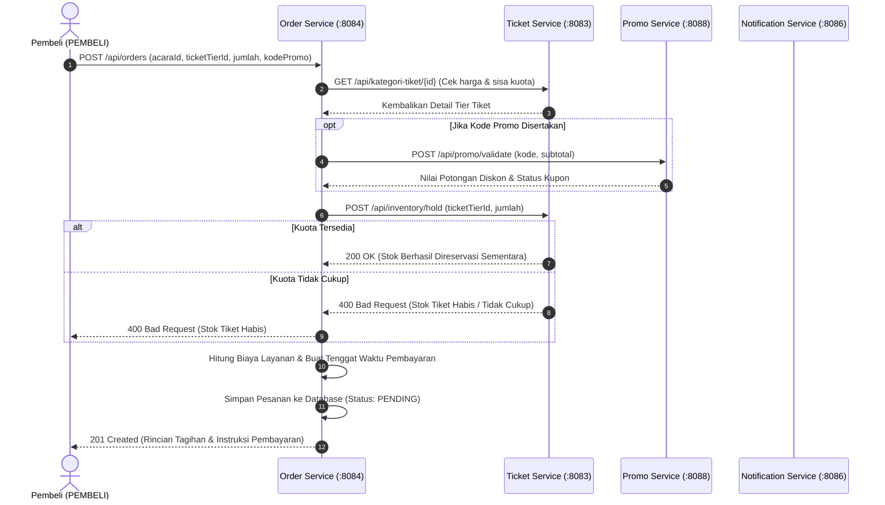
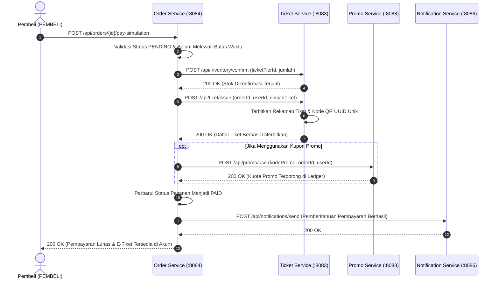
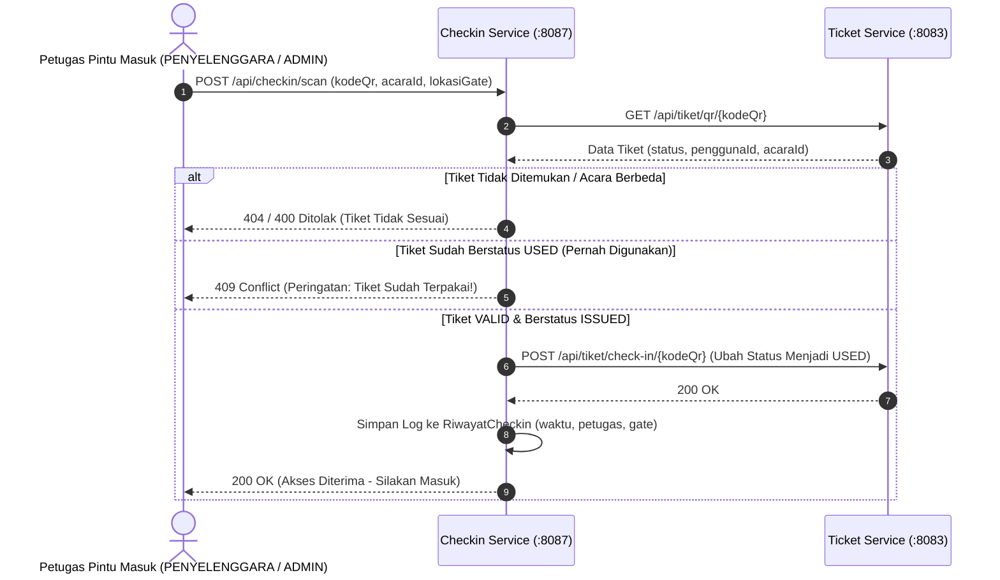

# TIKARA - Platform Tiket Konser & Acara Berbasis Microservices

[](https://openjdk.org/)
[](https://spring.io/projects/spring-boot)
[](https://www.postgresql.org/)
[](#arsitektur-sistem)
[](#autentikasi--otorisasi)
[](#dokumentasi-api)

**TIKARA** adalah platform tiket konser musik, festival, dan acara *live entertainment* berskala enterprise yang dirancang menggunakan arsitektur **microservices**. Platform ini dibangun untuk mengatasi tantangan kritis pada sistem tiket dengan lonjakan transaksi tinggi, pencegahan tiket palsu dan penggunaan ganda melalui validasi kode QR kriptografis, pembersihan otomatis reservasi tiket yang kedaluwarsa (*scheduled janitor*), penguncian kuota dua tahap (*two-phase inventory hold*), penerbitan e-tiket PDF A4 resmi, serta pemisahan hak akses berbasis peran (*Role-Based Access Control* / RBAC).

TIKARA membagi ekosistem tiket menjadi **8 (delapan) microservice otonom** berbasis Java 17 dan Spring Boot 3.4.3. Setiap microservice memiliki basis data PostgreSQL terpisah yang menerapkan pola arsitektur **Database-per-Service** serta menyajikan antarmuka web mandiri (*Web Views*) berbasis HTML5, Vanilla CSS3 modern, dan JavaScript.

---

## Daftar Isi

- [Ringkasan Sistem](#ringkasan-sistem)
- [Fitur Utama](#fitur-utama)
- [Arsitektur Sistem](#arsitektur-sistem)
- [Layanan Microservices & Pemetaan Port](#layanan-microservices--pemetaan-port)
- [Daftar Halaman Antarmuka Web (Frontend Routes)](#daftar-halaman-antarmuka-web-frontend-routes)
- [Technology Stack](#technology-stack)
- [Struktur Proyek](#struktur-proyek)
- [Dokumentasi Flowchart (Draw.io)](#dokumentasi-flowchart-drawio)
- [Arsitektur Database (ERD)](#arsitektur-database-erd)
- [Autentikasi, Otorisasi & Keamanan](#autentikasi-otorisasi--keamanan)
- [Dokumentasi API](#dokumentasi-api)
- [Alur Pengguna & Bisnis](#alur-pengguna--bisnis)
- [Diagram Alur (Sequence Diagrams)](#diagram-alur-sequence-diagrams)
- [Instalasi & Panduan Setup](#instalasi--panduan-setup)
- [Konfigurasi Lingkungan](#konfigurasi-lingkungan)
- [Menjalankan Layanan](#menjalankan-layanan)
- [Akun Demo & Kredensial Pengujian](#akun-demo--kredensial-pengujian)
- [Pengujian (Testing)](#pengujian-testing)
- [Penanganan Error](#penanganan-error)
- [Kontrol Keamanan](#kontrol-keamanan)
- [Panduan Pengembangan](#panduan-pengembangan)
- [Panduan Pemecahan Masalah (Troubleshooting)](#panduan-pemecahan-masalah-troubleshooting)
- [Pertimbangan Lingkungan Produksi](#pertimbangan-lingkungan-produksi)
- [Roadmap Proyek](#roadmap-proyek)
- [Keterbatasan Sistem](#keterbatasan-sistem)
- [Panduan Kontribusi](#panduan-kontribusi)
- [Lisensi](#lisensi)

---

## Ringkasan Sistem

Sistem tiket acara langsung membutuhkan isolasi tanggung jawab yang ketat, pencegahan kelebihan penjualan (*overbooking*), dan integritas data transaksional yang konsisten. TIKARA memisahkan fungsionalitas ke dalam domain microservices yang terisolasi dengan basis data independen.

Sistem TIKARA dirancang berdasarkan 3 (tiga) peran (*role*) pengguna utama:

### 1. Pembeli (`PEMBELI`)
- **Katalog Publik**: Menjelajahi katalog acara aktif, melakukan pencarian berdasarkan kata kunci, kota venue, serta filter kategori/genre musik.
- **Detail Acara & Kategori**: Melihat informasi detail acara, denah venue, harga tiket, dan ketersediaan kuota per tier.
- **Reservasi Dua Tahap (*Two-Phase Hold*)**: Mengunci kuota tiket sementara secara otomatis saat checkout untuk mencegah *race condition* atau *overbooking*.
- **Voucher Promo**: Memasukkan kupon diskon promo yang tervalidasi nominal dan kuotanya.
- **Simulasi Pembayaran**: Menyelesaikan simulasi pembayaran sebelum tenggat waktu (*deadline*) pembayaran berakhir.
- **E-Tiket & PDF A4**: Melihat tiket digital dengan kode QR dan barcode, mengunduh berkas e-tiket PDF A4 resmi, serta opsi kirim tiket ke email.
- **Transfer Tiket**: Mentransfer tiket digital ke email pembeli lain yang terdaftar di platform secara aman.
- **Ulasan & Rating Berverifikasi**: Memberikan ulasan dan rating acara yang diverifikasi otomatis bahwa pengguna benar-benar memiliki tiket acara terkait.

### 2. Penyelenggara Acara (`PENYELENGGARA`)
- **Pengajuan Acara**: Mendaftarkan proposal acara baru dengan jadwal, lokasi venue, poster gambar.
- **Pengaturan Tier Tiket**: Membuat kategori tiket (seperti VIP, Festival, Early Bird, Presale), menentukan harga jual, kuota kapasitas, dan periode penjualan.
- **Dashboard & Analitik Penyelenggara**: Memantau laju penjualan tiket, sisa kuota, dan grafik analitik omzet pendapatan per acara.
- **Terminal Gate Check-in**: Mengoperasikan pemindai kode QR kamera langsung (`scan-gate.html`) di pintu masuk venue untuk verifikasi tiket dan pencegahan *double-entry*.
- **Manifes Penonton**: Mengakses daftar penonton (*attendee manifest*) dan timeline kedatangan penonton per jam.

### 3. Administrator Platform (`ADMIN`)
- **Executive Analytics Dashboard**: Memantau kesehatan platform secara agregat (total omzet omset seluruh sistem via koneksi multi-datasource JDBC, total pengguna terdaftar, acara aktif, dan volume transaksi).
- **Moderasi Acara**: Menyetujui (`ACTIVE`) atau menolak (`REJECTED`) proposal acara yang masuk dari penyelenggara disertai catatan moderator.
- **Manajemen Promo Platform**: Membuat kode promo diskon, mengatur persentase potongan, nominal diskon maksimal, syarat minimal belanja, kuota pemakaian, dan status aktif/nonaktif.
- **Audit Logging Terpusat**: Memeriksa log audit sistem yang bersifat *immutable* untuk melacak aktivitas administratif dan operasional penting beserta IP address.
- **Laporan Rekapitulasi**: Mengakses laporan rekapitulasi penjualan tiket dan rekonsiliasi data transaksi.

---

## Fitur Utama

Fitur-fitur TIKARA dikelompokkan berdasarkan batas domain layanan (*bounded context*):

### 1. Autentikasi, Pengguna & Profil (`user_service`)
- **Stateless JWT**: Penerbitan token HMAC-SHA256 yang memuat identitas pengguna, email, dan peran (*role*).
- **Siklus Refresh Token**: Masa berlaku token akses 24 jam dan refresh token 7 hari untuk pembaruan sesi tanpa login ulang.
- **Kebijakan Kata Sandi Ketat**: Validasi password minimal 8 karakter, diawali huruf kapital, memiliki minimal 1 angka, dan minimal 1 simbol (contoh: `Password123!`).
- **Registrasi dengan Pilihan Peran**: Form registrasi mendukung pendaftaran akun sebagai `PEMBELI` atau `PENYELENGGARA`. Pendaftaran peran `ADMIN` diproteksi dari registrasi publik.
- **Reset Kata Sandi Mandiri (OTP)**: Pengiriman kode OTP 6-digit ke email melalui SMTP JavaMail dengan masa berlaku 10 menit, diikuti verifikasi token reset (15 menit).
- **Profil Lengkap & Unggah Avatar**: Manajemen nomor telepon, tanggal lahir, alamat, serta unggah berkas foto avatar pengguna (`/uploads/avatars/`).
- **Validasi Penerima Transfer**: Endpoint `/api/users/check-recipient` untuk memvalidasi keberadaan akun tujuan sebelum transfer tiket dieksekusi.

### 2. Manajemen Katalog Acara & Ulasan (`event_service`)
- **State Machine Siklus Acara**: Alur siklus hidup acara: `PENDING_REVIEW` &rarr; `ACTIVE` / `REJECTED` &rarr; `COMPLETED`.
- **Taksonomi Kategori & Genre**: Pengelompokan genre musik standar (Pop, Rock, Jazz, Indie, EDM, Dangdut, Klasik, Hip-Hop).
- **Media Multipart Upload**: Penyimpanan berkas media poster promosi (`/uploads/posters/`) dan panduan flyer PDF (`/uploads/flyers/`).
- **Mesin Ulasan Berverifikasi**: Pengiriman ulasan dan rating bintang (1-5) yang divalidasi ke `ticket_service` guna memastikan pengguna telah membeli tiket acara tersebut.

### 3. Inventaris Kuota, E-Tiket & Transfer (`ticket_service`)
- **Two-Phase Inventory Hold**: Mekanisme penguncian stok tiket sementara (`HOLD`) saat checkout untuk mencegah *overbooking*.
- **Pelepasan & Konfirmasi Kuota**: Konfirmasi kuota menjadi `terjual` saat pembayaran lunas (`CONFIRM`), atau pengembalian stok saat pembatalan / kedaluwarsa (`RELEASE` / `RETURN`).
- **Penerbitan E-Tiket Kriptografis**: Kode QR berbasis UUID unik untuk setiap lembar tiket yang diterbitkan (`ISSUED`).
- **Generator Dokumen PDF A4**: Pembuatan berkas e-tiket PDF A4 dinamis menggunakan OpenPDF dan matriks QR Code dari ZXing.
- **Pengiriman E-Tiket via Email**: Transmisi e-tiket berlampiran PDF langsung ke kotak masuk email pengguna.

### 4. Transaksi Checkout & Pembayaran (`order_service`)
- **Perhitungan Rincian Tagihan**: Komputasi subtotal tiket, biaya layanan (*service fee*), biaya admin, dan potongan kupon diskon promo.
- **Batas Waktu Pembayaran (Deadline)**: Setiap pesanan yang dibuat memiliki tenggat waktu pembayaran (`tenggatPembayaran`).
- **Scheduler Pembersih Pesanan Kedaluwarsa**: Pekerjaan latar belakang (*background scheduler*) yang mengeksekusi setiap 10 detik untuk membatalkan pesanan yang melewati batas waktu dan otomatis mengembalikan kuota tiket ke `ticket_service`.
- **Simulasi Pembayaran Instan**: Endpoint pembayaran lunas yang secara atomik memicu konfirmasi kuota, penerbitan tiket, pemotongan kuota promo, dan pengiriman notifikasi.

### 5. Mesin Diskon & Promosi (`promo_service`)
- **Validasi Kupon Fleksibel**: Perhitungan diskon persentase dengan batasan potongan maksimal, minimal transaksi belanja, masa berlaku, dan sisa kuota promo.
- **Ledger Pemakaian Promo**: Pencatatan riwayat pemakaian promo per pesanan serta pemulihan kuota saat pesanan terkait dibatalkan.
- **Tata Kelola Promo Admin**: Panel aktivasi, deaktivasi, serta pembuatan kode promo baru.

### 6. Pusat Notifikasi Terpusat (`notification_service`)
- **Notifikasi Transaksional Terpusat**: Notifikasi in-app untuk status pesanan, pembayaran, transfer tiket, dan hasil moderasi acara.
- **Badge Notifikasi Belum Dibaca**: Menghitung jumlah notifikasi yang belum dibaca dan menandai notifikasi telah dibaca.

### 7. Check-in Gate & Kontrol Pintu Masuk (`checkin_service`)
- **Pemindai Kamera QR Scanner**: Antarmuka web responsif dengan integrasi kamera perangkat scanner HTML5 (`scan-gate.html`).
- **Pencegahan Tiket Duplikat (*Anti-Double Entry*)**: Tiket divalidasi ke `ticket_service`. Tiket yang sudah berstatus `USED` atau tidak valid langsung ditolak.
- **Analitik Kedatangan**: Menampilkan kurva statistik distribusi waktu kedatangan penonton per jam di venue.

### 8. Konsol Administrasi Eksekutif (`admin_service`)
- **Agregasi Metrik JDBC Multi-Datasource**: Layanan `RealtimeMetricsService` mengeksekusi query langsung ke database layanan lain untuk menghitung total omzet pendapatan, pengguna, dan acara secara instan.
- **Audit Logging Terpusat**: Pencatatan riwayat aksi operasional sistem secara *immutable* lengkap dengan IP address.
- **Moderasi Proposal Acara**: Tinjauan antrean acara masuk dengan opsi setujui atau tolak beserta catatan moderator.
- **Laporan Penjualan Tiket**: Rekapitulasi penjualan tiket dan omzet per acara.

---

## Arsitektur Sistem

TIKARA dibangun dengan pola **Poly-Service Monorepo**, di mana seluruh layanan berada dalam satu repositori namun memiliki dependensi Maven, konfigurasi *runtime*, dan basis data PostgreSQL yang berdiri sendiri.

### Pola Arsitektur
1. **Microservices Architecture**: Pemisahan fungsionalitas berdasarkan domain bisnis mandiri.
2. **Database-per-Service**: 8 database PostgreSQL terpisah tanpa dependensi *foreign key* fisik antarlayanan.
3. **Stateless Authentication**: Verifikasi JWT menggunakan kunci rahasia simetris (`jwt.secret`) yang seragam di semua layanan.
4. **Komunikasi Antarlayanan Sinkron**: Orkestrasi HTTP M2M menggunakan Spring `RestTemplate` dengan meneruskan token otentikasi.
5. **Scheduled Janitor**: Pembersihan otomatis pesanan kedaluwarsa pada `order_service` untuk menjaga ketersediaan inventaris tiket.

```mermaid
flowchart TB
    subgraph Clients["Klien & Antarmuka Web"]
        Browser["Web Browser (Desktop / Tablet / Mobile)"]
        GateStaff["Terminal Pemindai Kamera Petugas Gate"]
    end

    subgraph UserDomain["Domain Identitas & Pengguna"]
        UserService["User Service (:8081)"]
        UserDB[("db_user_service\n(PostgreSQL)")]
        UserService --> UserDB
    end

    subgraph EventDomain["Domain Katalog & Ulasan Acara"]
        EventService["Event Service (:8082)"]
        EventDB[("db_event_service\n(PostgreSQL)")]
        EventService --> EventDB
    end

    subgraph TicketDomain["Domain Tiket & Inventaris"]
        TicketService["Ticket Service (:8083)"]
        TicketDB[("db_ticket_service\n(PostgreSQL)")]
        TicketService --> TicketDB
    end

    subgraph OrderDomain["Domain Pesanan & Checkout"]
        OrderService["Order Service (:8084)"]
        OrderDB[("db_order_service\n(PostgreSQL)")]
        OrderService --> OrderDB
    end

    subgraph PromoDomain["Domain Promosi & Diskon"]
        PromoService["Promo Service (:8088)"]
        PromoDB[("db_promo_service\n(PostgreSQL)")]
        PromoService --> PromoDB
    end

    subgraph NotificationDomain["Domain Notifikasi"]
        NotificationService["Notification Service (:8086)"]
        NotificationDB[("db_notification_service\n(PostgreSQL)")]
        NotificationService --> NotificationDB
    end

    subgraph CheckinDomain["Domain Akses & Check-in"]
        CheckinService["Checkin Service (:8087)"]
        CheckinDB[("db_checkin_service\n(PostgreSQL)")]
        CheckinService --> CheckinDB
    end

    subgraph AdminDomain["Domain Administrasi Platform"]
        AdminService["Admin Service (:8089)"]
        AdminDB[("db_admin_service\n(PostgreSQL)")]
        AdminService --> AdminDB
    end

    %% Akses Klien
    Browser -->|Auth, Profil & OTP| UserService
    Browser -->|Jelajah Katalog & Ulasan| EventService
    Browser -->|Pilih Tiket & Tiket Saya| TicketService
    Browser -->|Checkout & Pembayaran| OrderService
    Browser -->|Pusat Notifikasi| NotificationService
    GateStaff -->|Pindai Tiket Masuk Gate| CheckinService
    Browser -->|Konsol Admin & Moderasi| AdminService

    %% Komunikasi Antar-Layanan
    OrderService -.->|Hold / Release / Confirm Kuota| TicketService
    OrderService -.->|Validasi & Pemotongan Promo| PromoService
    OrderService -.->|Kirim Notifikasi Pesanan| NotificationService
    EventService -.->|Verifikasi Kepemilikan Tiket Ulasan| TicketService
    EventService -.->|Notifikasi Moderasi Acara| NotificationService
    TicketService -.->|Validasi Email Penerima Transfer| UserService
    TicketService -.->|Notifikasi Transfer Tiket| NotificationService
    CheckinService -.->|Validasi & Update Status Tiket| TicketService
    AdminService -.->|Agregasi Metrik JDBC Langsung| UserDB
    AdminService -.->|Agregasi Metrik JDBC Langsung| EventDB
    AdminService -.->|Agregasi Metrik JDBC Langsung| OrderDB
    AdminService -.->|Agregasi Metrik JDBC Langsung| TicketDB
```



---

## Layanan Microservices & Pemetaan Port

| Microservice | Port | Basis Data PostgreSQL | Tanggung Jawab Utama |
|---|:---:|---|---|
| `user_service` | **8081** | `db_user_service` | Registrasi akun, otentikasi JWT, reset sandi OTP, profil pengguna, validasi email penerima transfer |
| `event_service` | **8082** | `db_event_service` | Katalog konser publik, pencarian & filter, upload media (poster/flyer), ulasan penonton berverifikasi |
| `ticket_service` | **8083** | `db_ticket_service` | Kategori tiket, two-phase inventory hold, penerbitan e-tiket QR, generator PDF A4, transfer tiket, kirim email |
| `order_service` | **8084** | `db_order_service` | Intake checkout, rincian biaya, scheduler pembersih otomatis (10s), simulasi pembayaran, pendapatan acara |
| `notification_service` | **8086** | `db_notification_service` | Ingesti notifikasi sistem, pelacakan status dibaca, unread count badge |
| `checkin_service` | **8087** | `db_checkin_service` | Pemindai QR gate kamera langsung, pencegahan tiket duplikat, timeline kedatangan penonton |
| `promo_service` | **8088** | `db_promo_service` | Validasi kupon promo, ledger penggunaan kupon, pengembalian kuota diskon, tata kelola promo |
| `admin_service` | **8089** | `db_admin_service` | Executive Realtime Metrics (multi-datasource JDBC), moderasi proposal acara, audit log, laporan penjualan |

> [!NOTE]
> Microservice `queue_service` (port 8085) yang sempat ada pada iterasi awal telah dilepas dari arsitektur. Penguncian kuota transaksi saat lonjakan pembelian kini ditangani langsung secara presisi dan efisien melalui mekanisme *Two-Phase Inventory Hold* pada `ticket_service` dan `order_service`.

---

## Daftar Halaman Antarmuka Web (Frontend Routes)

Setiap microservice menyajikan halaman web mandiri (*Web Views*) responsif modern yang dapat diakses langsung melalui browser:

### 1. Katalog & Halaman Umum (`event_service` - Port 8082)
- **Beranda & Katalog Acara**: [http://localhost:8082/](http://localhost:8082/) atau `/index.html` (Pencarian, filter genre, daftar konser aktif)
- **Detail Acara & Ulasan**: [http://localhost:8082/event-detail.html?id=1](http://localhost:8082/event-detail.html?id=1) (Deskripsi, venue, ulasan penonton, tombol beli)
- **Buat Acara Baru**: [http://localhost:8082/create-event.html](http://localhost:8082/create-event.html) (Form pengajuan acara bagi penyelenggara)
- **Daftar Acara Saya**: [http://localhost:8082/my-events.html](http://localhost:8082/my-events.html) (Manajemen status acara yang diajukan organizer)
- **Dashboard Penyelenggara**: [http://localhost:8082/organizer-dashboard.html](http://localhost:8082/organizer-dashboard.html) (Analitik penjualan dan omzet organizer)
- **Halaman Statis Informasi**:
  - Tentang Kami: [http://localhost:8082/about.html](http://localhost:8082/about.html)
  - Blog & Berita Musik: [http://localhost:8082/blog.html](http://localhost:8082/blog.html)
  - Panduan Kreator / EO: [http://localhost:8082/creator-guide.html](http://localhost:8082/creator-guide.html)
  - Pusat Bantuan & FAQ: [http://localhost:8082/help.html](http://localhost:8082/help.html)
  - Syarat & Ketentuan: [http://localhost:8082/terms.html](http://localhost:8082/terms.html)

### 2. Autentikasi & Akun (`user_service` - Port 8081)
- **Masuk Akun (Login)**: [http://localhost:8081/login.html](http://localhost:8081/login.html) atau `/login` (Mendukung parameter `?redirect=...`)
- **Pendaftaran Akun (Register)**: [http://localhost:8081/register.html](http://localhost:8081/register.html) atau `/register` (Pilihan peran `PEMBELI` / `PENYELENGGARA`)
- **Lupa Kata Sandi**: [http://localhost:8081/forgot-password.html](http://localhost:8081/forgot-password.html) (Permintaan kode OTP 6-digit ke email)
- **Verifikasi OTP**: [http://localhost:8081/verify-otp.html](http://localhost:8081/verify-otp.html) (Verifikasi OTP untuk memperoleh token reset)
- **Ganti Kata Sandi Baru**: [http://localhost:8081/reset-password.html](http://localhost:8081/reset-password.html) (Input kata sandi baru)
- **Profil Pengguna**: [http://localhost:8081/profile.html](http://localhost:8081/profile.html) (Ubah data diri, kata sandi, dan foto avatar)

### 3. Tiket & Koleksi Saya (`ticket_service` - Port 8083)
- **Pemilihan Tiket**: [http://localhost:8083/pilih-tiket.html?acaraId=1](http://localhost:8083/pilih-tiket.html?acaraId=1) (Pilih tier tiket, kuantitas, dan lanjut checkout)
- **Tiket Saya**: [http://localhost:8083/my-tickets.html](http://localhost:8083/my-tickets.html) (Lihat e-tiket, QR barcode, unduh PDF A4, kirim ke email, transfer tiket)

### 4. Transaksi & Pembayaran (`order_service` - Port 8084)
- **Halaman Checkout**: [http://localhost:8084/checkout.html](http://localhost:8084/checkout.html) (Rincian pesanan, input kupon promo, rincian biaya)
- **Simulasi Pembayaran**: [http://localhost:8084/pembayaran.html?orderId=1](http://localhost:8084/pembayaran.html?orderId=1) (Countdown tenggat waktu dan simulasi bayar lunas)
- **Riwayat Pesanan**: [http://localhost:8084/my-orders.html](http://localhost:8084/my-orders.html) (Daftar transaksi pesanan, status, bayar/batalkan)

### 5. Pusat Notifikasi (`notification_service` - Port 8086)
- **Kotak Masuk Notifikasi**: [http://localhost:8086/notifications.html](http://localhost:8086/notifications.html) (Riwayat notifikasi, tandai dibaca)

### 6. Terminal Pintu Masuk (`checkin_service` - Port 8087)
- **Terminal Pemindai QR Gate**: [http://localhost:8087/scan-gate.html](http://localhost:8087/scan-gate.html) (Pemindai kamera QR scanner html5-qrcode, riwayat check-in, kurva timeline penonton)

### 7. Konsol Admin Platform (`admin_service` - Port 8089)
- **Executive Admin Dashboard**: [http://localhost:8089/admin-dashboard.html](http://localhost:8089/admin-dashboard.html) (Ringkasan omzet lintas basis data, laporan penjualan, log audit)
- **Moderasi Acara**: [http://localhost:8089/event-moderation.html](http://localhost:8089/event-moderation.html) (Antrean proposal acara: setujui / tolak)
- **Manajemen Kode Promo**: [http://localhost:8089/promo-management.html](http://localhost:8089/promo-management.html) (Buat promo baru, aktifkan/nonaktifkan kupon)
- **Organizer Dashboard Admin View**: [http://localhost:8089/organizer-dashboard.html](http://localhost:8089/organizer-dashboard.html) & `organizer-event-detail.html`

---

## Technology Stack

| Kategori | Pustaka / Komponen | Versi | Peruntukan dalam Sistem |
|---|---|---|---|
| **Bahasa & Runtime** | Java (OpenJDK) | `17` | Lingkungan runtime dasar seluruh 8 microservice |
| **Framework Backend** | Spring Boot | `3.4.3` | Fondasi aplikasi backend di seluruh service |
| **Keamanan** | Spring Security | `6.4.x` | Keamanan tingkat metode (`@PreAuthorize`) dan filter chain |
| **Token Kriptografis** | JJWT (io.jsonwebtoken) | `0.12.6` | Pembuatan, parsing, dan verifikasi tanda tangan JWT |
| **Persistensi Data** | Spring Data JPA / Hibernate | `6.6.x` | Abstraksi ORM, repositori JPA, dan manajemen transaksi |
| **Basis Data** | PostgreSQL | `14+` | Relational datastore mandiri per microservice (8 DB) |
| **Driver Basis Data** | PostgreSQL JDBC Driver | `42.7.x` | Konektivitas JDBC dan multi-datasource di `admin_service` |
| **Validasi Input** | Jakarta Bean Validation | `3.0.x` | Validasi payload request (`@Valid`, `@NotBlank`, `@Min`, `@Size`) |
| **Generator Dokumen PDF**| OpenPDF (LibrePDF) | `2.0.3` | Pembuatan dokumen e-tiket resmi format A4 (`ticket_service`) |
| **Barcode & QR Code** | ZXing Core & JavaSE | `3.5.3` | Pembuatan matriks gambar QR Code untuk tiket (`ticket_service`) |
| **Layanan Email** | Spring Boot Starter Mail | `3.4.3` | Transmisi email OTP reset password dan lampiran tiket PDF via SMTP |
| **Dokumentasi API** | Springdoc OpenAPI Starter WebMVC | `2.8.5` | Swagger UI & spesifikasi OpenAPI v3 di setiap service |
| **Boilerplate Helper** | Project Lombok | Latest | Anotasi `@Getter`, `@Setter`, `@Builder`, `@Data`, dan `@Slf4j` |
| **Template Mesin** | Thymeleaf | `3.1.x` | Rendering tampilan antarmuka admin dashboard di `admin_service` |
| **Antarmuka Web** | HTML5, Vanilla CSS3, JavaScript (ES6) | Native | Desain modern, responsif mobile-first, dan glassmorphism |
| **Build Tool** | Apache Maven | `3.8+` | Manajemen dependensi dan proses kompilasi |

---

## Struktur Proyek

```text
tiketkonser-fullstack/
├── admin_service/                  # Port 8089: Metrik admin, audit log, moderasi acara
│   ├── src/main/java/com/tiketkonser/admin_service/
│   │   ├── config/                 # SecurityConfig, PasswordConfig, OpenApiConfig
│   │   ├── controller/             # AdminController, WebViewController
│   │   ├── entity/                 # Entitas AuditLog, LaporanPenjualan
│   │   ├── handler/                # GlobalExceptionHandler
│   │   ├── payload/                # DTO Request & Response
│   │   ├── repository/             # Spring Data JpaRepositories
│   │   ├── security/               # JwtService, JwtAuthenticationFilter
│   │   └── service/                # RealtimeMetricsService, AdminServiceImpl
│   └── src/main/resources/
│       ├── application.properties
│       ├── static/                 # CSS & JS aset antarmuka admin
│       └── templates/              # Thymeleaf: admin-dashboard, event-moderation, promo-management
├── checkin_service/                # Port 8087: Validasi scan QR gate & kontrol masuk
│   ├── src/main/java/com/tiketkonser/checkin_service/
│   │   ├── controller/             # CheckinController, WebViewController
│   │   ├── entity/                 # Entitas RiwayatCheckin
│   │   └── service/                # CheckinServiceImpl (validasi tiket & statistik timeline)
│   └── src/main/resources/
│       └── static/                 # scan-gate.html & aset pemindai kamera QR
├── event_service/                  # Port 8082: Katalog acara, kategori, ulasan penonton
│   ├── src/main/java/com/tiketkonser/event_service/
│   │   ├── controller/             # AcaraController, KategoriController, UlasanController
│   │   ├── entity/                 # Entitas Acara, Kategori, Ulasan
│   │   └── service/                # AcaraServiceImpl, UlasanServiceImpl
│   └── src/main/resources/
│       └── static/                 # index.html, event-detail.html, create-event.html, my-events.html, dsb
├── notification_service/           # Port 8086: Ingesti notifikasi & pencatatan dibaca
│   ├── src/main/java/com/tiketkonser/notification_service/
│   │   ├── controller/             # NotifikasiController, WebViewController
│   │   ├── entity/                 # Entitas Notifikasi
│   │   └── service/                # NotifikasiServiceImpl
│   └── src/main/resources/
│       └── static/                 # notifications.html & stylesheet
├── order_service/                  # Port 8084: Checkout, simulasi bayar, scheduler janitor
│   ├── src/main/java/com/tiketkonser/order_service/
│   │   ├── controller/             # PemesananController
│   │   ├── entity/                 # Entitas Pemesanan, DetailPemesanan
│   │   ├── scheduler/              # OrderCleanupScheduler (interval 10s auto-cancel)
│   │   └── service/                # PemesananServiceImpl
│   └── src/main/resources/
│       └── static/                 # checkout.html, pembayaran.html, my-orders.html
├── promo_service/                  # Port 8088: Validasi kupon promo & ledger pemakaian
│   ├── src/main/java/com/tiketkonser/promo_service/
│   │   ├── controller/             # PromoController
│   │   ├── entity/                 # Entitas KodePromo, PenggunaanPromo
│   │   └── service/                # PromoServiceImpl
│   └── src/main/resources/
│       └── static/                 # Skrip & utilitas promo
├── ticket_service/                 # Port 8083: Kategori tiket, inventaris hold, PDF, QR, transfer
│   ├── src/main/java/com/tiketkonser/ticket_service/
│   │   ├── controller/             # InventoryController, KategoriTiketController, TiketController
│   │   ├── entity/                 # Entitas KategoriTiket, Tiket
│   │   └── service/                # PdfTicketService, EmailTicketService, TiketServiceImpl
│   └── src/main/resources/
│       └── static/                 # pilih-tiket.html, my-tickets.html
├── user_service/                   # Port 8081: Identitas pengguna, token JWT, profil, OTP
│   ├── src/main/java/com/tiketkonser/user_service/
│   │   ├── controller/             # AuthController, PenggunaController, WebViewController
│   │   ├── entity/                 # Entitas Pengguna, ProfilPengguna, ResetPasswordOtp
│   │   └── service/                # PenggunaServiceImpl, EmailServiceImpl
│   └── src/main/resources/
│       └── static/                 # login.html, register.html, profile.html, forgot-password.html, dsb
├── uploads/                        # Repositori penyimpanan berkas media lokal
│   ├── avatars/                    # Foto profil avatar pengguna
│   ├── flyers/                     # Berkas flyer panduan acara format PDF
│   └── posters/                    # Gambar poster acara
├── TIKARA_FIX_Flowchart.drawio     # Berkas visualisasi flowchart lengkap sistem (11 halaman)
└── README.md                       # Dokumentasi utama proyek
```

---

## Dokumentasi Flowchart (Draw.io)

Sistem TIKARA dilengkapi dengan dokumentasi alur bisnis lengkap dalam berkas [`TIKARA_FIX_Flowchart.drawio`](file:///c:/DEA%20AFRILIA%20-%20TIKARA/tiketkonser-fullstack/TIKARA_FIX_Flowchart.drawio) yang dapat dibuka menggunakan aplikasi [Draw.io Desktop](https://www.drawio.com/) atau ekstensi VS Code Draw.io Integration.

Berkas ini memuat **11 (sebelas) halaman diagram alur komprehensif**:

1. **Halaman 1: Flowchart Utama** — Gambaran umum peta navigasi sistem dari beranda, autentikasi, hingga transaksi.
2. **Halaman 2: Login & Cek Role** — Alur otentikasi kredensial, verifikasi password BCrypt, penerbitan JWT, dan penentuan navigasi berdasarkan peran (`PEMBELI`, `PENYELENGGARA`, `ADMIN`).
3. **Halaman 3: Registrasi Akun** — Validasi kebijakan kata sandi, pemilihan peran, dan pembuatan rekaman profil pengguna awal.
4. **Halaman 4: Beranda & Beli Tiket** — Penelusuran katalog acara, filter kategori, pemilihan tier tiket, dan penguncian kuota awal (*Hold*).
5. **Halaman 5: Form Pembayaran** — Validasi kupon diskon promo, rincian biaya layanan, perhitungan total harga, countdown timer, dan eksekusi pembayaran.
6. **Halaman 6: Profil & Tiket Saya** — Manajemen data profil, upload avatar, penampilan repositori e-tiket ber-barcode QR, unduh PDF A4, dan transfer tiket ke pengguna lain.
7. **Halaman 7: Dashboard Organizer** — Pengajuan acara baru, unggah poster/flyer, penentuan tier tiket, dan pemantauan analitik pendapatan acara.
8. **Halaman 8: Terminal Scan Gate** — Pemindaian kode QR penonton melalui kamera, validasi keabsahan tiket, pencegahan *double entry*, dan pencatatan riwayat check-in.
9. **Halaman 9: Moderasi Admin** — Antrean kurasi proposal acara baru, verifikasi data acara, persetujuan (`ACTIVE`) atau penolakan (`REJECTED`) disertai catatan moderator.
10. **Halaman 10: Manajemen Promo** — Pembuatan kode promo diskon, pengaturan kuota, batas maksimal potongan, tanggal berlaku, dan pengaktifan/penonaktifan kupon.
11. **Halaman 11: Laporan & Search** — Agregasi laporan rekapitulasi penjualan tiket, pencarian data multi-parameter, dan audit log kepatuhan sistem.

---

## Arsitektur Database (ERD)

TIKARA menerapkan pola **Database-per-Service** secara disiplin. Setiap layanan mengelola skema PostgreSQL masing-masing tanpa ada relasi *foreign key* lintas database fisik.

```mermaid
erDiagram
    %% USER SERVICE (db_user_service)
    PENGGUNA ||--o| PROFIL_PENGGUNA : memiliki
    PENGGUNA ||--o{ RESET_PASSWORD_OTP : meminta
    PENGGUNA {
        bigint id PK
        varchar nama
        varchar email UK
        varchar kata_sandi_hash
        varchar peran
        timestamp created_at
        timestamp updated_at
        timestamp deleted_at
    }
    PROFIL_PENGGUNA {
        bigint id PK
        bigint pengguna_id FK
        varchar nomor_telepon
        date tanggal_lahir
        text alamat
        varchar foto_profil_url
        timestamp created_at
        timestamp updated_at
    }
    RESET_PASSWORD_OTP {
        bigint id PK
        varchar email
        varchar otp_code
        timestamp expired_at
        boolean is_used
        timestamp created_at
    }

    %% EVENT SERVICE (db_event_service)
    KATEGORI ||--o{ ACARA_KATEGORI : dikaitkan
    ACARA ||--o{ ACARA_KATEGORI : memiliki
    ACARA ||--o{ ULASAN : menerima
    ACARA {
        bigint id PK
        bigint organizer_id
        varchar organizer_nama
        varchar nama
        text deskripsi
        varchar venue
        varchar kota
        timestamp tanggal_mulai
        timestamp tanggal_selesai
        varchar status
        text gambar_url
        text catatan_moderator
        timestamp moderated_at
        timestamp created_at
        timestamp updated_at
        timestamp deleted_at
    }
    KATEGORI {
        bigint id PK
        varchar nama_kategori UK
        timestamp created_at
        timestamp updated_at
    }
    ACARA_KATEGORI {
        bigint acara_id FK
        bigint kategori_id FK
    }
    ULASAN {
        bigint id PK
        bigint acara_id FK
        bigint pengguna_id
        varchar pengguna_nama
        int rating
        text komentar
        timestamp created_at
    }

    %% TICKET SERVICE (db_ticket_service)
    KATEGORI_TIKET ||--o{ TIKET : menerbitkan
    KATEGORI_TIKET {
        bigint id PK
        bigint acara_id
        varchar nama_kategori
        numeric harga
        int kuota
        int terjual
        int direservasi
        timestamp mulai_jual
        timestamp selesai_jual
        varchar status
    }
    TIKET {
        bigint id PK
        bigint kategori_tiket_id FK
        bigint detail_pemesanan_id
        bigint pengguna_id
        varchar kode_qr UK
        varchar status
        timestamp diterbitkan_at
        timestamp digunakan_at
        timestamp deleted_at
    }

    %% ORDER SERVICE (db_order_service)
    PEMESANAN ||--|{ DETAIL_PEMESANAN : memiliki
    PEMESANAN {
        bigint id PK
        bigint pengguna_id
        varchar nomor_pesanan UK
        numeric subtotal_tiket
        numeric biaya_layanan
        numeric biaya_admin
        numeric diskon
        varchar kode_promo
        numeric total_harga
        varchar status
        timestamp tenggat_pembayaran
        timestamp created_at
        timestamp updated_at
        timestamp deleted_at
    }
    DETAIL_PEMESANAN {
        bigint id PK
        bigint pemesanan_id FK
        bigint kategori_tiket_id
        varchar nama_kategori_tiket
        int jumlah
        numeric harga_satuan
        numeric subtotal
    }

    %% PROMO SERVICE (db_promo_service)
    KODE_PROMO ||--o{ PENGGUNAAN_PROMO : mencatat
    KODE_PROMO {
        bigint id PK
        varchar kode UK
        numeric persen_diskon
        numeric potongan_maksimal
        numeric minimal_transaksi
        int kuota_promo
        int terpakai
        timestamp mulai_berlaku
        timestamp selesai_berlaku
        varchar status
    }
    PENGGUNAAN_PROMO {
        bigint id PK
        bigint kode_promo_id FK
        bigint pengguna_id
        bigint pemesanan_id
        numeric potongan_didapat
        timestamp digunakan_at
    }

    %% NOTIFICATION SERVICE (db_notification_service)
    NOTIFIKASI {
        bigint id PK
        bigint pengguna_id
        varchar judul
        text pesan
        varchar tipe
        varchar status
        boolean dibaca
        timestamp created_at
    }

    %% CHECKIN SERVICE (db_checkin_service)
    RIWAYAT_CHECKIN {
        bigint id PK
        bigint acara_id
        bigint tiket_id
        varchar kode_qr
        bigint petugas_id
        varchar lokasi_gate
        varchar status_checkin
        timestamp waktu_checkin
    }

    %% ADMIN SERVICE (db_admin_service)
    AUDIT_LOG {
        bigint id PK
        bigint pengguna_id
        varchar aksi
        varchar modul
        text detail
        varchar ip_address
        timestamp created_at
    }
    LAPORAN_PENJUALAN {
        bigint id PK
        bigint acara_id
        int total_tiket_terjual
        numeric total_pendapatan
        varchar periode
        timestamp created_at
    }
```



---

## Autentikasi, Otorisasi & Keamanan

TIKARA mengimplementasikan mekanisme keamanan *stateless* menggunakan JSON Web Token (JJWT) dengan enkripsi tanda tangan HMAC-SHA256.

### 1. Struktur Token & Masa Berlaku
- **Access Token**:
  - Masa Berlaku: 24 Jam (`jwt.expiration=86400000`).
  - Claims: `sub` (Email Pengguna), `userId` (ID Pengguna), `role` (Peran Pengguna), `type: ACCESS`.
- **Refresh Token**:
  - Masa Berlaku: 7 Hari (`refreshExpiration=604800000L`).
  - Claims: `sub` (Email Pengguna), `type: REFRESH`.
- **Reset Password Token**:
  - Masa Berlaku: 15 Menit (`resetPasswordExpiration=900000L`).
  - Claims: `sub` (Email Pengguna), `type: RESET_PASSWORD`.

### 2. Kebijakan Kata Sandi (Password Policy)
Saat mendaftarkan akun baru atau memperbarui kata sandi, sistem memvalidasi ketentuan berikut:
- Minimal panjang **8 karakter**.
- Karakter pertama harus **huruf kapital** (`A-Z`).
- Memiliki minimal **1 digit angka** (`0-9`).
- Memiliki minimal **1 simbol unik** (seperti `!`, `@`, `#`, `$`, `%`, dst.).
- Contoh format sandi yang valid: `Password123!`.

### 3. Proteksi Peran Publik (Role Guarding)
- Registrasi publik (`/api/auth/register` dan `/register.html`) hanya menerima peran `PEMBELI` atau `PENYELENGGARA`.
- Pendaftaran akun dengan peran `ADMIN` diblokir secara terprogram pada layer service guna mencegah eskalasi hak istimewa (*privilege escalation*). Akun admin diinisialisasi melalui database atau kredensial yang telah ditentukan.

### 4. Pipeline Filter Spring Security
Setiap service mengonfigurasikan `JwtAuthenticationFilter` yang diturunkan dari `OncePerRequestFilter`:
1. Mengekstrak header `Authorization: Bearer <token>` atau query token (untuk unduhan PDF).
2. Memverifikasi keabsahan tanda tangan token dengan kunci rahasia simetris `jwt.secret`.
3. Memastikan token belum kedaluwarsa dan tipe token sesuai (`type: ACCESS`).
4. Memetakan peran pengguna ke dalam otorisasi Spring Security dengan awalan `ROLE_` (contoh: `ROLE_PEMBELI`, `ROLE_PENYELENGGARA`, `ROLE_ADMIN`).
5. Menyimpan objek `UsernamePasswordAuthenticationToken` ke dalam `SecurityContextHolder`.

---

## Dokumentasi API

Setiap microservice menyediakan Swagger UI interaktif di `http://localhost:<PORT>/swagger-ui.html` dan spesifikasi OpenAPI 3 di `http://localhost:<PORT>/v3/api-docs`.

### 1. User Service (`:8081`)

| Method | Endpoint | Deskripsi | Hak Akses |
|---|---|---|---|
| `POST` | `/api/auth/register` | Pendaftaran pengguna baru (`PEMBELI` / `PENYELENGGARA`) | Publik |
| `POST` | `/api/auth/login` | Autentikasi pengguna, menghasilkan Access & Refresh token | Publik |
| `POST` | `/api/auth/refresh-token` | Memperbarui access token menggunakan refresh token | Publik |
| `POST` | `/api/auth/logout` | Mengakhiri sesi pengguna aktif | Terautentikasi |
| `POST` | `/api/auth/forgot-password` | Meminta kode OTP 6-digit yang dikirimkan ke email | Publik |
| `POST` | `/api/auth/verify-otp` | Memvalidasi kode OTP dan memperoleh token reset sandi | Publik |
| `POST` | `/api/auth/reset-password` | Memperbarui kata sandi dengan token reset yang valid | Publik |
| `GET` | `/api/users/profile` (atau `/me`) | Mengambil profil pengguna yang sedang login | Terautentikasi |
| `PUT` | `/api/users/profile` | Memperbarui data profil (nama, telepon, tgl lahir, alamat) | Terautentikasi |
| `PUT` | `/api/users/change-password` | Mengganti kata sandi dengan validasi sandi lama | Terautentikasi |
| `POST` | `/api/users/profile/upload-avatar` | Mengunggah foto profil avatar (Multipart form-data) | Terautentikasi |
| `GET` | `/api/users` | Pencarian dan daftar pengguna dengan paginasi | `ROLE_ADMIN` |
| `GET` | `/api/users/{id}` | Mengambil detail profil pengguna berdasarkan ID | Terautentikasi (Owner / Admin) |
| `GET` | `/api/users/email/{email}` | Mengambil data profil pengguna berdasarkan email | Terautentikasi (Owner / Admin) |
| `PUT` | `/api/users/{id}` | Pembaruan data pengguna oleh administrator | `ROLE_ADMIN` |
| `DELETE` | `/api/users/{id}` | Penghapusan akun pengguna secara lunak (*soft delete*) | `ROLE_ADMIN` |
| `PATCH` | `/api/users/{id}/restore` | Memulihkan akun pengguna yang sebelumnya dihapus | `ROLE_ADMIN` |
| `GET` | `/api/users/check-recipient` | Memvalidasi keberadaan akun tujuan transfer tiket | Terautentikasi |

### 2. Event Service (`:8082`)

| Method | Endpoint | Deskripsi | Hak Akses |
|---|---|---|---|
| `GET` | `/api/acara` (atau `/api/events`) | Mengambil katalog konser dengan filter pencarian & kategori | Publik |
| `GET` | `/api/acara/{id}` | Mengambil detail lengkap konser berdasarkan ID | Publik |
| `POST` | `/api/acara` | Mengajukan proposal acara baru (`PENDING_REVIEW`) | `PENYELENGGARA`, `ADMIN` |
| `GET` | `/api/acara/my-events` | Daftar acara milik penyelenggara yang sedang login | `PENYELENGGARA`, `ADMIN` |
| `GET` | `/api/acara/organizer/analytics`| Ringkasan analitik penjualan & omzet organizer | `PENYELENGGARA`, `ADMIN` |
| `GET` | `/api/acara/{id}/detail-organizer` | Detail komprehensif acara untuk panel manajemen organizer | `PENYELENGGARA`, `ADMIN` |
| `PUT` | `/api/acara/{id}` | Memperbarui informasi metadata acara | `PENYELENGGARA`, `ADMIN` |
| `DELETE` | `/api/acara/{id}` | Menghapus acara secara lunak (*soft delete*) | `PENYELENGGARA`, `ADMIN` |
| `PATCH` | `/api/acara/{id}/status` | Mengubah status aktif / nonaktif acara | `PENYELENGGARA`, `ADMIN` |
| `POST` | `/api/acara/{id}/upload-poster` | Mengunggah gambar poster promosi konser | `PENYELENGGARA`, `ADMIN` |
| `POST` | `/api/acara/{id}/upload-flyer` | Mengunggah flyer panduan acara format PDF | `PENYELENGGARA`, `ADMIN` |
| `GET` | `/api/acara/pending-review` | Antrean proposal acara yang menunggu kurasi admin | `ROLE_ADMIN` |
| `POST` / `PATCH` | `/api/acara/{id}/moderate` | Menyetujui (`ACTIVE`) atau menolak (`REJECTED`) acara | `ROLE_ADMIN` |
| `PATCH` | `/api/acara/{id}/resubmit` | Mengajukan ulang acara yang sebelumnya ditolak moderator | `PENYELENGGARA`, `ADMIN` |
| `PATCH` | `/api/acara/{id}/restore` | Memulihkan acara yang sebelumnya dihapus | `ROLE_ADMIN` |
| `GET` | `/api/kategori` | Mengambil seluruh daftar taksonomi kategori/genre | Publik |
| `POST` | `/api/kategori` | Menambahkan kategori genre baru | `ROLE_ADMIN` |
| `GET` | `/api/kategori/{id}` | Mengambil detail kategori berdasarkan ID | Publik |
| `POST` | `/api/acara/{acaraId}/ulasan` | Mengirimkan ulasan & rating bintang (1-5) | Terautentikasi (Pemilik Tiket) |
| `GET` | `/api/acara/{acaraId}/ulasan` | Mengambil daftar ulasan penonton untuk suatu acara | Publik |
| `GET` | `/api/acara/{acaraId}/ulasan/eligibility` | Memeriksa kelayakan pengguna untuk menulis ulasan | Terautentikasi |
| `DELETE`| `/api/acara/ulasan/{ulasanId}` | Menghapus ulasan oleh moderator | `ROLE_ADMIN` |

### 3. Ticket Service (`:8083`)

| Method | Endpoint | Deskripsi | Hak Akses |
|---|---|---|---|
| `GET` | `/api/kategori-tiket/acara/{acaraId}` | Mengambil daftar tier tiket & kuota pada acara | Publik |
| `GET` | `/api/kategori-tiket/{id}` | Mengambil detail tier tiket berdasarkan ID | Publik |
| `POST` | `/api/kategori-tiket` | Membuat tier tiket baru (VIP, Festival, dsb) | `PENYELENGGARA`, `ADMIN` |
| `PUT` | `/api/kategori-tiket/{id}` | Memperbarui harga, kuota, atau periode penjualan | `PENYELENGGARA`, `ADMIN` |
| `POST` | `/api/inventory/hold` | Mengunci stok tiket sementara saat checkout (*hold*) | Internal / Publik |
| `POST` | `/api/inventory/release` | Melepaskan kuota yang terkunci (batal/kedaluwarsa) | Internal / Publik |
| `POST` | `/api/inventory/confirm` | Mengonfirmasi kuota menjadi terjual saat bayar lunas | Internal / Publik |
| `POST` | `/api/inventory/return` | Mengembalikan kuota tiket saat terjadi pembatalan | Internal / Publik |
| `POST` | `/api/tiket/issue` | Menerbitkan e-tiket resmi baru dengan kode QR | Internal / Publik |
| `GET` | `/api/tiket/saya` | Menampilkan seluruh e-tiket yang dimiliki pengguna | Terautentikasi |
| `GET` | `/api/tiket/qr/{kodeQr}` | Mengambil data tiket berdasarkan kode QR unik | Terautentikasi |
| `POST` | `/api/tiket/check-in/{kodeQr}` | Validasi check-in masuk pintu venue | `PENYELENGGARA`, `ADMIN` |
| `POST` | `/api/tiket/{id}/transfer` | Mentransfer tiket ke email pengguna lain yang terdaftar | Terautentikasi |
| `GET` | `/api/tiket/{id}/pdf` (atau `/download-pdf`) | Mengunduh e-tiket resmi format PDF A4 ber-barcode QR | Terautentikasi |
| `POST` | `/api/tiket/{id}/send-email` | Mengirimkan berkas PDF e-tiket ke email pengguna | Terautentikasi |
| `POST` | `/api/tiket/refund-by-detail/{detailId}` | Membatalkan/refund lembar tiket berdasarkan detail order | Internal / Publik |
| `GET` | `/api/tiket/has-ticket` | Memverifikasi kepemilikan tiket acara oleh pengguna | Terautentikasi |
| `GET` | `/api/tiket/acara/{acaraId}/stats` | Statistik kapasitas dan persentase tiket terjual | `PENYELENGGARA`, `ADMIN` |
| `GET` | `/api/tiket/acara/{acaraId}/manifest`| Mengambil daftar manifes penonton untuk kebutuhan gate | `PENYELENGGARA`, `ADMIN` |

### 4. Order Service (`:8084`)

| Method | Endpoint | Deskripsi | Hak Akses |
|---|---|---|---|
| `POST` | `/api/orders` | Membuat pesanan baru, hold kuota, dan hitung biaya | Terautentikasi |
| `GET` | `/api/orders/saya` | Mengambil riwayat belanja tiket pengguna | Terautentikasi |
| `GET` | `/api/orders/{id}` | Mengambil rincian detail lengkap pesanan | Terautentikasi |
| `POST` | `/api/orders/{id}/cancel` | Membatalkan pesanan dan mengembalikan kuota tiket | Terautentikasi |
| `POST` | `/api/orders/{id}/pay-simulation` | Simulasi bayar lunas & memicu penerbitan tiket | Terautentikasi |
| `GET` | `/api/orders/acara/{acaraId}/revenue` | Rekapitulasi pendapatan kotor dan transaksi acara | Terautentikasi |

### 5. Promo Service (`:8088`)

| Method | Endpoint | Deskripsi | Hak Akses |
|---|---|---|---|
| `GET` | `/api/promo` | Mengambil daftar kupon promo yang sedang aktif | Publik |
| `GET` | `/api/promo/{id}` | Mengambil detail kupon promo berdasarkan ID | Publik |
| `POST` | `/api/promo/validate` | Memvalidasi syarat kupon dan kalkulasi nilai diskon | Internal / Publik |
| `POST` | `/api/promo/use` | Mencatat penggunaan kupon dan mengurangi sisa kuota | Internal / Publik |
| `POST` | `/api/promo/cancel-usage/{pemesananId}` | Mengembalikan kuota kupon jika pesanan dibatalkan | Internal / Publik |
| `GET` | `/api/promo/all` | Daftar seluruh kupon promo untuk panel administrasi | `ROLE_ADMIN` |
| `GET` | `/api/promo/stats` | Statistik efektivitas dan penggunaan promo | `ROLE_ADMIN` |
| `POST` | `/api/promo` | Membuat kupon promo diskon baru | `ROLE_ADMIN` |
| `PATCH` | `/api/promo/{id}/toggle-status` | Mengaktifkan atau menonaktifkan kupon promo | `ROLE_ADMIN` |
| `PATCH` | `/api/promo/{id}/deactivate` | Menonaktifkan kupon promo secara permanen | `ROLE_ADMIN` |

### 6. Notification Service (`:8086`)

| Method | Endpoint | Deskripsi | Hak Akses |
|---|---|---|---|
| `POST` | `/api/notifications/send` | Ingesti pesan notifikasi baru ke kotak masuk pengguna | Internal / Publik |
| `GET` | `/api/notifications/saya` | Mengambil daftar notifikasi milik pengguna login | Terautentikasi |
| `GET` | `/api/notifications/unread-count` | Menghitung jumlah notifikasi yang belum dibaca | Terautentikasi |
| `PUT` | `/api/notifications/{id}/read` | Menandai suatu pesan notifikasi telah dibaca | Terautentikasi |

### 7. Check-in Service (`:8087`)

| Method | Endpoint | Deskripsi | Hak Akses |
|---|---|---|---|
| `POST` | `/api/checkin/scan` | Pindai QR, validasi status, dan catat akses masuk penonton | `PENYELENGGARA`, `ADMIN` |
| `GET` | `/api/checkin/history/{acaraId}` | Riwayat log penonton yang telah check-in di gate | `PENYELENGGARA`, `ADMIN` |
| `GET` | `/api/checkin/stats/{acaraId}` | Statistik penonton hadir vs tiket terjual | `PENYELENGGARA`, `ADMIN` |
| `GET` | `/api/checkin/acara/{acaraId}/timeline`| Distribusi grafik penonton masuk venue per jam | `PENYELENGGARA`, `ADMIN` |

### 8. Admin Service (`:8089`)

| Method | Endpoint | Deskripsi | Hak Akses |
|---|---|---|---|
| `GET` | `/api/admin/dashboard/summary` | Ringkasan metrik platform eksekutif (omzet, pengguna, acara) | `ROLE_ADMIN` |
| `GET` | `/api/admin/reports/sales` | Laporan rekapitulasi penjualan tiket per acara | `ROLE_ADMIN` |
| `GET` | `/api/admin/audit-logs` | Mengambil riwayat catatan audit operasional | `ROLE_ADMIN` |
| `POST` | `/api/admin/audit-logs` | Menambahkan catatan audit aksi sistem | Terautentikasi |

---

## Alur Pengguna & Bisnis

### 1. Alur Pembeli (Customer Flow)
```text
Daftar Akun / Masuk (Login)
       ↓
Jelajahi Katalog Acara Aktif & Cari Berdasarkan Genre/Kota
       ↓
Lihat Halaman Detail Acara & Pilih Kategori Tiket
       ↓
Mulai Checkout (Mengunci kuota tiket sementara via Two-Phase Hold ticket_service)
       ↓
Gunakan Kode Promo (Opsional, divalidasi via promo_service)
       ↓
Periksa Rincian Biaya & Perhatikan Batas Waktu Pembayaran
       ↓
Simulasi Bayar Lunas (pay-simulation)
       ├── Berhasil → Tiket Diterbitkan → Notifikasi Masuk → Unduh Berkas PDF A4 / Transfer
       └── Batal / Kedaluwarsa → Scheduler Melepas Kuota Kembali → Status DIBATALKAN
       ↓
Hari Acara: Tunjukkan Kode QR Tiket di Pintu Masuk → Pindai Check-in Berhasil
```

### 2. Alur Penyelenggara (Organizer Flow)
```text
Masuk Akun sebagai PENYELENGGARA
       ↓
Buat Pengajuan Acara Baru & Unggah Poster/Flyer (event_service)
       ↓
Acara Berstatus PENDING_REVIEW Menunggu Kurasi Admin
       ├── Ditolak → Pelajari Catatan Moderator → Perbaiki & Ajukan Ulang (Resubmit)
       └── Disetujui → Status Acara Menjadi ACTIVE
       ↓
Buat Kategori Tiket, Atur Harga & Kuota Penjualan (ticket_service)
       ↓
Pantau Laju Penjualan & Total Pendapatan Real-Time (organizer-dashboard.html)
       ↓
Hari Acara: Buka Terminal Scanner (scan-gate.html) → Pindai Kode QR Tiket Penonton
```

### 3. Alur Administrator Platform (Admin Flow)
```text
Masuk Akun sebagai ADMIN
       ↓
Buka Dashboard Eksekutif (admin-dashboard.html)
       ↓
Pantau Metrik Real-time: Total Omzet Penjualan Lintas DB, Pengguna Aktif, Acara, Transaksi
       ↓
Antrean Moderasi Acara (event-moderation.html) → Verifikasi Proposal → Setujui / Tolak
       ↓
Tata Kelola Promo (promo-management.html) → Buat Kupon, Pantau Kuota, Nonaktifkan Kupon
       ↓
Audit Sistem: Tinjau Log Aktivitas Petugas & Laporan Rekapitulasi Penjualan
```

---

## Diagram Alur (Sequence Diagrams)

### 1. Alur Pemesanan & Penguncian Kuota Dua Tahap (Order & Hold)


### 2. Alur Pembayaran & Penerbitan E-Tiket Resmi


### 3. Alur Check-in Pintu Masuk Venue (Gate Check-in)


---

## Instalasi & Panduan Setup

### Prasyarat Sistem
- **Java Development Kit (JDK)**: Versi 17 terinstal dan terdaftar di `JAVA_HOME`.
- **PostgreSQL**: Versi 14 atau lebih baru berjalan di `localhost:5432`.
- **Apache Maven**: Versi 3.8+ (atau gunakan Maven Wrapper bawaan: `./mvnw` / `.\mvnw.cmd`).
- **Browser Modern**: Chrome, Firefox, Safari, atau Edge dengan izin kamera (untuk scan QR gate).
- **Akun SMTP (Opsional)**: Untuk pengiriman OTP reset sandi dan pengiriman lampiran e-tiket PDF.

### 1. Clone Repositori
```bash
git clone https://github.com/<organisasi-anda>/tiketkonser-fullstack.git
cd tiketkonser-fullstack
```

### 2. Pembuatan Basis Data PostgreSQL
TIKARA membutuhkan **8 (delapan) database** terpisah. Eksekusi perintah SQL berikut di `psql` atau pgAdmin:

```sql
CREATE DATABASE db_user_service;
CREATE DATABASE db_event_service;
CREATE DATABASE db_ticket_service;
CREATE DATABASE db_order_service;
CREATE DATABASE db_promo_service;
CREATE DATABASE db_notification_service;
CREATE DATABASE db_checkin_service;
CREATE DATABASE db_admin_service;
```

### 3. Buat Folder Penyimpanan Berkas Media Lokal
Pastikan folder penampung berkas unggahan telah dibuat di direktori root proyek:

```bash
# Linux / macOS
mkdir -p uploads/avatars uploads/posters uploads/flyers

# Windows (PowerShell)
New-Item -ItemType Directory -Force -Path uploads\avatars, uploads\posters, uploads\flyers
```

### 4. Inisialisasi Akun Admin
Pendaftaran publik melarang pembuatan akun dengan peran `ADMIN` untuk keamanan. Jalankan query SQL berikut pada database `db_user_service` untuk membuat akun administrator awal (Kata Sandi: `Password123!`):

```sql
\c db_user_service;

-- Tambahkan Pengguna Admin
INSERT INTO pengguna (nama, email, kata_sandi_hash, peran, created_at, updated_at)
VALUES (
    'Admin Tikara',
    'admin@tikara.com',
    '$2a$10$wT3Wp.g7Y7hC98f5r6Y3aei7V9wXh029uW635fQxJb9qI/7m5qHce',
    'ADMIN',
    NOW(),
    NOW()
) ON CONFLICT (email) DO NOTHING;

-- Tambahkan Profil Pengguna Admin
INSERT INTO profil_pengguna (pengguna_id, nomor_telepon, alamat, created_at, updated_at)
SELECT id, '081234567890', 'Kantor Pusat TIKARA, Jakarta', NOW(), NOW()
FROM pengguna WHERE email = 'admin@tikara.com'
ON CONFLICT DO NOTHING;
```

### 5. Inisialisasi Data Awal (Seed Data Minimal 20 Baris)
Untuk memenuhi ketentuan pengujian sistem dengan data awal yang memadai, berkas [`seed_data.sql`](file:///c:/DEA%20AFRILIA%20-%20TIKARA/tiketkonser-fullstack/seed_data.sql) telah disediakan di root proyek. Berkas ini memuat **minimal 20 baris data realistis** untuk setiap tabel utama (`pengguna`, `profil_pengguna`, `acara`, `ulasan`, `kategori_tiket`, `tiket`, `kode_promo`, `pemesanan`, dan `detail_pemesanan`).

Anda dapat mengeksekusinya langsung melalui terminal atau pgAdmin:
```bash
# Eksekusi seed data via psql
psql -U postgres -f seed_data.sql
```
*(Atau Anda juga dapat mendaftar dan membuat acara secara manual melalui tampilan web antarmuka).*


---

## Konfigurasi Lingkungan

Konfigurasi aplikasi dapat disesuaikan pada berkas `application.properties` masing-masing layanan atau menggunakan *environment variables*:

| Variabel Lingkungan | Layanan Terkait | Nilai Default | Deskripsi | Wajib di Produksi |
|---|---|---|---|:---:|
| `SPRING_DATASOURCE_URL` | Semua Layanan | `jdbc:postgresql://localhost:5432/db_<service>` | URL koneksi JDBC database | Ya |
| `SPRING_DATASOURCE_USERNAME` | Semua Layanan | `postgres` | Username koneksi database | Ya |
| `SPRING_DATASOURCE_PASSWORD` | Semua Layanan | Tidak ada (wajib dikonfigurasi) | Password koneksi PostgreSQL | Ya |
| `JWT_SECRET` | Semua Layanan | Tidak ada (wajib dibuat sendiri) | Kunci rahasia untuk menandatangani JWT | Ya |
| `JWT_EXPIRATION` | User Service | `86400000` (24 jam) | Masa berlaku access token (ms) | Tidak |
| `SPRING_MAIL_HOST` | User, Ticket | `smtp.gmail.com` | Host server SMTP email | Ya |
| `SPRING_MAIL_PORT` | User, Ticket | `587` | Port koneksi SMTP | Tidak |
| `SPRING_MAIL_USERNAME` | User, Ticket | `<your-email>` | Alamat email otentikasi SMTP | Ya |
| `SPRING_MAIL_PASSWORD` | User, Ticket | `<your-app-password>` | App Password SMTP | Ya |

> [!IMPORTANT]
> Nilai `jwt.secret` harus sama persis di seluruh 8 microservice agar token yang diterbitkan oleh `user_service` dapat diverifikasi oleh microservice lainnya.

---

## Menjalankan Layanan

Setiap microservice dapat dijalankan secara mandiri menggunakan Maven Wrapper bawaan:

### Linux / macOS
```bash
# Jalankan masing-masing di tab terminal terpisah:
cd user_service && ./mvnw spring-boot:run
cd event_service && ./mvnw spring-boot:run
cd ticket_service && ./mvnw spring-boot:run
cd order_service && ./mvnw spring-boot:run
cd promo_service && ./mvnw spring-boot:run
cd notification_service && ./mvnw spring-boot:run
cd checkin_service && ./mvnw spring-boot:run
cd admin_service && ./mvnw spring-boot:run
```

### Windows (PowerShell)
```powershell
# Jalankan masing-masing di jendela PowerShell terpisah:
cd user_service; .\mvnw.cmd spring-boot:run
cd event_service; .\mvnw.cmd spring-boot:run
cd ticket_service; .\mvnw.cmd spring-boot:run
cd order_service; .\mvnw.cmd spring-boot:run
cd promo_service; .\mvnw.cmd spring-boot:run
cd notification_service; .\mvnw.cmd spring-boot:run
cd checkin_service; .\mvnw.cmd spring-boot:run
cd admin_service; .\mvnw.cmd spring-boot:run
```

Setelah layanan aktif, buka browser di [http://localhost:8082/](http://localhost:8082/) untuk mengakses halaman beranda katalog konser TIKARA.

---

## Akun Demo & Pengujian Role

TIKARA menyediakan tiga peran pengguna untuk menguji autentikasi, otorisasi, dan alur bisnis sistem.

| Role | Hak Akses & Fitur Pengujian |
|---|---|
| **Administrator (ADMIN)** | Moderasi acara, manajemen promo, executive dashboard, audit log, dan laporan penjualan. |
| **Penyelenggara (PENYELENGGARA)** | Pengajuan acara, pengelolaan kategori dan kuota tiket, analitik penjualan, serta pemindaian QR check-in. |
| **Pembeli (PEMBELI)** | Pencarian acara, pemesanan tiket, penggunaan kupon, simulasi pembayaran, unduh e-ticket PDF, dan transfer tiket. |

> **Catatan Keamanan:** Kredensial akun pengujian tidak dipublikasikan dalam repository. Pengujian dilakukan menggunakan akun lokal dan konfigurasi lingkungan yang disiapkan secara terpisah.

Pengguna baru dapat mendaftar melalui `http://localhost:8081/register.html` sebagai **PEMBELI** atau **PENYELENGGARA**. Pendaftaran **ADMIN** tidak tersedia melalui registrasi publik.

---

## Pengujian (Testing)

Setiap microservice dilengkapi pengujian integrasi dan unit menggunakan **JUnit 5**, **Spring Boot Test**, dan pustaka asersi:

- **Context Loads**: Memvalidasi konfigurasi bean Spring, repositori JPA, dan security filter termuat dengan benar pada ke-8 microservice.
- **`ticket_service`**:
  - `testGenerateTicketPdf()` pada `TicketServiceApplicationTests.java`: Memvalidasi pembuatan array biner berkas PDF e-tiket valid (`> 3KB`), tidak bernilai null, dan tepat 1 halaman dokumen e-tiket ukuran A4 dengan barcode QR ZXing.
- **`admin_service`**:
  - `testRealtimeMetrics()` pada `AdminServiceApplicationTests.java`: Menguji konektivitas dan eksekusi query JDBC multi-datasource ke database layanan lain.
  - `testAdminDashboardControllerAuth()`: Menguji proteksi otorisasi halaman admin dashboard.

### Menjalankan Pengujian
```bash
# Menjalankan pengujian pada ticket_service
cd ticket_service
./mvnw test        # Linux / macOS
.\mvnw.cmd test    # Windows (PowerShell)
```

---

## Penanganan Error

Seluruh microservice menerapkan penanganan error terpusat menggunakan `@RestControllerAdvice` melalui kelas `GlobalExceptionHandler`.

### Format Respon Error Standar (`ErrorResponse`)
Digunakan untuk kode status 400 (Bad Request), 401 (Unauthorized), 403 (Forbidden), 404 (Not Found), 409 (Conflict), dan 500 (Internal Server Error):
```json
{
  "timestamp": "2026-09-18T14:00:00.123",
  "status": 404,
  "error": "NOT_FOUND",
  "message": "Acara dengan ID 10 tidak ditemukan",
  "path": "/api/acara/10"
}
```

### Format Respon Validasi Input (`ValidationErrorResponse`)
Digunakan saat terjadi kegagalan validasi Bean Validation pada DTO request (HTTP 400 Bad Request):
```json
{
  "timestamp": "2026-09-18T14:00:00.456",
  "status": 400,
  "error": "BAD_REQUEST",
  "message": "Validasi input gagal",
  "path": "/api/auth/register",
  "errors": {
    "email": "Format email tidak valid",
    "kataSandi": "Kata sandi minimal 8 karakter"
  }
}
```

### Halaman Tampilan Error Frontend Mandiri
Untuk memberikan pengalaman pengguna yang elegan saat terjadi kesalahan rute atau otorisasi, TIKARA menyediakan berkas halaman tampilan error responsif berdesain glassmorphism:
- **`401 Unauthorized`**: [http://localhost:8082/401.html](http://localhost:8082/401.html) — Akses ditolak karena pengguna belum login atau sesi token telah habis.
- **`403 Forbidden`**: [http://localhost:8082/403.html](http://localhost:8082/403.html) — Pengguna tidak memiliki hak akses / peran (*role*) yang disyaratkan.
- **`404 Not Found`**: [http://localhost:8082/404.html](http://localhost:8082/404.html) — Halaman atau acara konser yang dituju tidak ditemukan.
- **`500 Internal Server Error`**: [http://localhost:8082/500.html](http://localhost:8082/500.html) — Terjadi kendala teknis internal pada sistem.

---

## Kontrol Keamanan

1. **Hashing Kata Sandi Kuat**: Menggunakan algoritma BCrypt (`BCryptPasswordEncoder`) dengan *work factor* standar 10. Kata sandi mentah tidak pernah disimpan di database.
2. **Kebijakan Kata Sandi Berlapis**: Menolak pendaftaran atau perubahan sandi yang tidak memenuhi kriteria keamanan (minimal 8 karakter, huruf kapital di awal, minimal 1 angka, dan minimal 1 simbol).
3. **Autentikasi Stateless JWT**: Sesi tidak membebani memori server (*stateless*). Setiap permintaan diverifikasi melalui tanda tangan kriptografis HMAC-SHA256.
4. **Proteksi Peran Admin**: Endpoint registrasi publik secara tegas menolak pembuatan akun dengan peran `ADMIN`.
5. **Keamanan Berbasis Peran Tingkat Metode**: Otorisasi granular menggunakan anotasi `@PreAuthorize("hasRole('ADMIN')")` dan `@PreAuthorize("hasAnyRole('PENYELENGGARA', 'ADMIN')")`.
6. **Validasi & Sanitasi Data Masukan**: Perlindungan batas pintu masuk controller melalui Jakarta Bean Validation (`@Valid`, `@NotBlank`, `@Size`, `@Min`).
7. **Proteksi Injeksi SQL**: Penggunaan Spring Data JPA dan query berparameter Hibernate di seluruh layer repositori memastikan tidak ada perangkaian string SQL mentah.
8. **Sanitasi Jalur Unggah Berkas**: Penyimpanan berkas media dibatasi pada direktori `uploads/` dengan UUID acak untuk mencegah eksploitasi *directory traversal*.

---

## Panduan Pengembangan

Bagi pengembang yang ingin berkontribusi atau memodifikasi fungsionalitas layanan:

1. **Pemisahan Lapisan Kode (Layered Architecture)**:
   - `config/`: Konfigurasi bean Spring, otentikasi, CORS, dan Swagger OpenAPI.
   - `controller/`: Penanganan protokol HTTP, mapping endpoint, dan validasi DTO masukan.
   - `service/` & `service/impl/`: Logika bisnis domain, manajemen transaksi database (`@Transactional`), dan orkestrasi HTTP antarlayanan.
   - `repository/`: Antarmuka Spring Data JPA untuk interaksi database.
   - `entity/`: Definisi tabel JPA dan pemetaan kolom.
   - `payload/req/` & `payload/res/`: Objek DTO (*Data Transfer Object*) masukan dan keluaran.
   - `handler/`: Penanganan exception global dan custom exception domain.
2. **Isolasi Database**: Dilarang menambahkan relasi *foreign key* JPA fisik ke tabel milik service lain. Relasi antardomain hanya boleh merujuk ID skalar (contoh: `Long penggunaId`, `Long acaraId`).
3. **Enkapsulasi DTO**: Jangan pernah mengembalikan entitas JPA secara langsung sebagai isi respon controller. Selalu petakan entitas ke DTO respon khusus.
4. **Praktik Logging**: Gunakan logger `@Slf4j` pada level `INFO` atau `ERROR`. Hindari `System.out.println` pada jalur kode produksi.

---

## Panduan Pemecahan Masalah (Troubleshooting)

| Masalah | Kemungkinan Penyebab | Tindakan Perbaikan / Solusi |
|---|---|---|
| `Port already in use` | Ada instans aplikasi sebelumnya yang masih berjalan pada port tersebut | Cari PID proses: `netstat -ano \| findstr <PORT>` (Windows) atau `lsof -i :<PORT>` (Linux), lalu hentikan proses menggunakan `taskkill /PID <PID> /F` atau `kill -9 <PID>`. |
| `Connection refused: localhost:5432` | Layanan PostgreSQL belum berjalan atau port berbeda | Pastikan service PostgreSQL aktif melalui `services.msc` (Windows) atau `systemctl status postgresql` (Linux). |
| `Database "db_..." does not exist` | Salah satu dari 8 database belum dibuat di PostgreSQL | Buat database yang kurang menggunakan query SQL pada bagian Instalasi. |
| `HTTP 401 Unauthorized` | Token JWT tidak disertakan, format salah, atau telah kedaluwarsa | Sertakan header `Authorization: Bearer <token>` dan pastikan token masih dalam masa berlaku 24 jam. |
| `HTTP 403 Forbidden` | Akun tidak memiliki peran yang disyaratkan (`PENYELENGGARA` atau `ADMIN`) | Login menggunakan akun dengan peran yang sesuai atau sesuaikan kolom `peran` di database. |
| `Mail server connection failed` | Kredensial SMTP salah atau akun email memblokir login aplikasi | Pastikan `SPRING_MAIL_USERNAME` dan `SPRING_MAIL_PASSWORD` valid. Untuk akun Gmail, wajib aktifkan 2-Step Verification dan buat **App Password** 16 karakter. |
| `Panggilan antarlayanan menghasilkan 404 / 500` | Microservice yang dituju belum aktif | Pastikan seluruh service pendukung (misal: `ticket_service` di port 8083 saat `order_service` melakukan hold tiket) telah berjalan. |

---

## Pertimbangan Lingkungan Produksi

| Aspek Arsitektur | Kondisi Saat Ini (Development) | Rekomendasi untuk Lingkungan Produksi |
|---|---|---|
| **API Gateway** | Akses langsung ke port masing-masing service | Terapkan Spring Cloud Gateway atau Kong sebagai *single entrypoint* pada port `8080` |
| **Service Discovery** | URL statis (`localhost:<PORT>`) | Terapkan Netflix Eureka atau HashiCorp Consul untuk registrasi dinamis |
| **Konfigurasi Terpusat** | Berkas lokal `application.properties` | Terapkan Spring Cloud Config Server, HashiCorp Vault, atau AWS Secrets Manager |
| **Pesan Antarlayanan** | Panggilan HTTP sinkron via `RestTemplate` | Terapkan message broker asinkron (Apache Kafka atau RabbitMQ) untuk keandalan antrean |
| **Distributed Tracing** | Berkas log di konsol terminal | Terapkan OpenTelemetry, Micrometer Tracing, dan Grafana Tempo / Zipkin |
| **Kontainerisasi** | Eksekusi Maven mandiri di mesin lokal | Terapkan Dockerfile multi-stage untuk tiap service dan `docker-compose.yml` orkestrasi |
| **Payment Gateway** | Simulasi pembayaran instan internal | Integrasikan webhook pembayaran resmi berlisensi (Midtrans, Xendit, atau Stripe) |
| **Migrasi Skema Basis Data**| Hibernate `ddl-auto=update / validate` | Gunakan alat migrasi skema berbasis versi seperti Flyway atau Liquibase |

---

## Roadmap Proyek

### Fitur yang Telah Selesai Diimplementasikan
- [x] Pemisahan domain microservices secara penuh pada 8 layanan otonom.
- [x] Arsitektur Database-per-Service dengan 8 database PostgreSQL independen.
- [x] Antarmuka web responsif modern (*Web Views*) lengkap untuk seluruh alur pengguna di setiap service.
- [x] Dokumentasi visual 11 halaman flowchart komprehensif di `TIKARA_FIX_Flowchart.drawio`.
- [x] Autentikasi stateless JWT dengan refresh token 7 hari, proteksi peran admin publik, dan reset kata sandi via OTP email.
- [x] Kebijakan kata sandi ketat (panjang, huruf kapital, angka, simbol).
- [x] Mekanisme penguncian kuota dua tahap (*Two-Phase Hold, Confirm, & Release*).
- [x] Scheduler latar belakang untuk pembersihan otomatis tiket dan pesanan yang kedaluwarsa (interval 10s).
- [x] Generator berkas e-tiket PDF dinamis format A4 yang terintegrasi barcode matriks QR ZXing.
- [x] Fitur transfer e-tiket antarpengguna dengan validasi email penerima.
- [x] Antarmuka kamera pemindai QR check-in gate dengan visualisasi grafik timeline kedatangan penonton.
- [x] Dashboard analitik eksekutif dengan agregasi query JDBC multi-datasource real-time.
- [x] Mesin promo diskon dengan perhitungan batas potongan maksimal dan ledger pemakaian kuota.

### Rencana Pengembangan Mendatang
- [ ] Kontainerisasi penuh menggunakan Dockerfile dan `docker-compose.yml` untuk *one-click startup*.
- [ ] Implementasi API Gateway terpusat untuk integrasi rute dan CORS satu pintu.
- [ ] Implementasi Apache Kafka untuk pengiriman event asinkron antar-microservice.
- [ ] Integrasi webhook resmi *payment gateway* komersial (Midtrans / Xendit).
- [ ] Caching data katalog konser dan kuota tiket menggunakan Redis.

---

## Keterbatasan Sistem

- **Akses Port Langsung**: Klien saat ini berinteraksi langsung dengan port masing-masing service (`8081`–`8089`) karena belum adanya API Gateway terpusat.
- **Keterikatan Waktu HTTP Sinkron**: Komunikasi antarlayanan saat checkout tiket masih mengandalkan HTTP sinkron via `RestTemplate`. Jika service target mengalami *downtime*, alur transaksi terkait akan terhenti sementara.
- **Agregasi Metrik Admin Berbasis JDBC Langsung**: `admin_service` melalui `RealtimeMetricsService` mengakses database layanan lain secara langsung via JDBC sekunder demi kecepatan komputasi omzet real-time, bukan melalui konsumsi *event streaming* terdesentralisasi.
- **Pembayaran Berbasis Simulasi**: Transaksi pembayaran saat ini menggunakan simulasi internal via endpoint `/api/orders/{id}/pay-simulation`, belum terhubung ke gateway pembayaran komersial eksternal.

---

## Panduan Kontribusi

1. **Fork** repositori ini dan buat cabang (*branch*) fitur baru dari cabang utama (`main`):
   ```bash
   git checkout -b feature/nama-fitur-anda
   ```
2. **Patuhi Standar Kode**: Terapkan konvensi penamaan paket, enkapsulasi DTO, dan pastikan anotasi validasi Bean Validation disertakan pada setiap endpoint baru.
3. **Jalankan Pengujian**: Pastikan pengujian unit dan integrasi lolos:
   ```bash
   ./mvnw test
   ```
4. **Gunakan Conventional Commits**: Tuliskan pesan commit yang jelas dan terstruktur:
   ```bash
   git commit -m "feat(ticket_service): tambahkan validasi batas transfer tiket"
   ```
5. **Buka Pull Request (PR)**: Sertakan ringkasan perubahan dan bukti pengujian lokal.

---

## Lisensi

Proyek ini dikembangkan untuk kebutuhan platform tiket konser dan acara hiburan live TIKARA. Hak cipta dan izin penggunaan diatur oleh pengelola repositori TIKARA.
